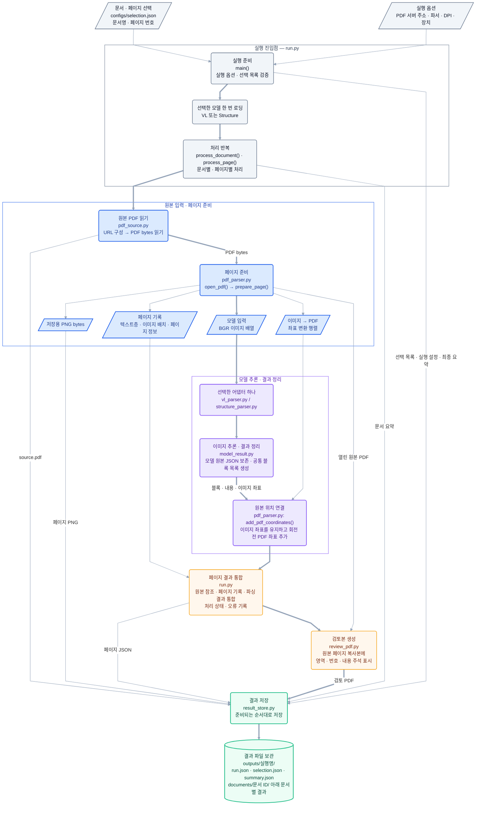

# MMDocIR Multimodal RAG

PDF의 텍스트·표·수식·그림을 원본 위치와 연결하고, 검색 결과의 실패 원인을 분석하는 학습·연구 프로젝트다.
현재 범위는 파싱부터 검색·평가까지이며 답변 생성은 포함하지 않는다.

```text
인덱싱: PDF → 파싱·검증 → 청킹 → 임베딩 → 저장·인덱싱
검색: 질문 → 채널별 후보 검색 → 공통 후보 매핑 → 결합 → 리랭킹 → Top 3
평가: 정답 누락·무관한 결과·최초 실패 단계 기록
```

## 현재 상태

| 항목 | 상태 |
|---|---|
| 입력 | 영어 PDF 9개 문서·27페이지의 특성별 표본 |
| 파싱 | PaddleOCR-VL v1.6 주 경로·PP-StructureV3 비교 경로, 좌표 연결·저장·실행 코드 |
| 실행 연결 | VL의 `parser_options()`·`build_parser()` 인자를 `run.py`와 맞추고 공통 추론 모듈 사용 |
| 검증 | 모델 없는 모의 결과·PDF 텍스트 추출·회전·CropBox 좌표 검증 수행 |
| 실제 실행 | 기존 VL 실행의 27페이지 처리 기록: `ok` 26개·`partial` 1개. 처리 상태이며 품질 판정이 아님 |
| 추가 실행 | 3M 9페이지 VL 파싱 완료(`ok`). 기존 문서 폴더에 JSON·PNG를 추가하고 검토 PDF를 8·9·15페이지로 갱신 |
| Structure 실행 | PP-StructureV3 27페이지(3M 8·9·15 포함) 처리 기록: `ok` 27개. 처리 상태이며 품질 판정이 아님 |
| 품질 검토 | 2026-10-30 선정 27페이지의 이미지·JSON 정성 비교. 반복·원문에 없는 내용, 문장–bbox 불일치, 표 행·열 대응 오류 확인. 정확도 점수는 미측정 |
| 남은 확인 | VL 영역 병합 옵션 비교, 반복·환각 식별, 문장 위치 복구와 표 구조 검증. 2026-11-08 VL 병합 기본값을 끄고 그림 crop 저장을 추가했으나 재실행은 미수행 |
| 규칙 검사 구현 | `parsing.validate_run`: 입력 해시·ID·좌표·반복·병합 그룹·표 격자·표 구조 토큰 상한·그림 참조 검사(규칙 0.3.0). 실제 54페이지 실행 확인은 0.1.0 기준. 원문 의미 정확도는 미측정 |
| 실행 기록·전후 비교 | 파싱 시 기본 기록과 최근 호환 실행의 자동 비교. 공통 manifest·소스 diff·모델 파일·RSS·정답 기반 문장/위치/표 평가·JSON/Markdown 보고서. 실제 원문 품질 개선은 미측정 |
| 기본 진입점 | 루트 `main.py`가 실행 설정을 읽어 HTTP·로컬 PDF 파싱·기록·자동 비교 실행. 모의 모델로 연속 실행 검증, 실제 신규 OCR 추론은 미수행 |
| 실행 재개 | `main.py --resume`으로 중단된 실행의 유효 페이지를 재사용하고 남은 페이지만 `run.py`의 같은 처리 경로로 처리. 처음 실행에 고정한 비교 기준을 이어 씀. 모의 테스트만 확인. 이 기능 추가 전에 중단된 실행은 코드가 달라 재개 불가(새로 실행) |
| 재파싱 | 병합 해제 후 VL·Structure 27페이지 재파싱 완료(컨테이너, VL은 한 번 중단 후 재개). VL 병합 그룹 22→0, 빈 text 블록 23→0, 규칙 검사 검토 페이지 14→3. bbox·라벨은 같음. Structure 블록 출력은 기준과 같음. 정답 대조는 미수행 ([병합 해제 재파싱](docs/parsing/log/2026-11-11_vl.md)) |
| 재인식 | VL 출력이 생성 한도(4,096토큰)에 닿은 블록만 576 DPI로 다시 인식(`parsing.rerecognize`). 3개 중 Toyota p2·p7 채택, 슬라이드 p6 미복구. 원래 파싱 결과는 그대로 두고 별도 폴더에 저장 ([VL 생성 한도 반복](docs/parsing/log/2026-11-11_vl.md#4-vlm-영역-인식-생성-한도까지-반복된-출력)) |
| 청킹 | 레이아웃 블록 구조 기반 청킹. 재파싱 결과 + 재인식 적용으로 VL 170개(신호 12)·Structure 147개(신호 28) 청크, 미배정 블록 0, 512토큰 초과 0. 복구 못 한 반복 블록은 사유와 함께 제외. 근거 보존은 미측정 ([청킹 README](docs/chunking/README.md)) |
| 이후 단계 | 임베딩·인덱스·검색·리랭킹·Recall@1·@3·@10 평가는 미구현 |

이전 PyMuPDF 실행은 8개 문서·24페이지 기록이다. 현재 27페이지나 새 모델 파이프라인의 검증 결과로 취급하지 않는다.
선정 목록은 [configs/selection.json](configs/selection.json), 문서별 관찰은 [DATA_SPEC.md](docs/data/DATA_SPEC.md)에 기록했다.
`3M_2018_10K`의 대상은 8·9·15페이지로 정정했다. 기존 VL 실행의 7·8·15페이지 기록은 보존하고,
9페이지만 추가할 때는 [configs/selection_3m_page9.json](configs/selection_3m_page9.json)을 사용한다.
추가 결과는 기존 실행의 `documents/<문서 ID>/`에 보관했다. 이 문서의 `review_vl.pdf`는
8·9·15페이지 통합 검토본이며, 페이지별 bbox는 각각 6·19·18개다. 별도 추가 실행 폴더는 남기지 않았다.
추가 실행 조건은 `page_00009_run.json`, 현재 검토 대상은 `document.json`과 `review_pages_8_9_15.json`에 기록했다.
실행 루트의 `run.json`·`summary.json`은 최초 실행 기록으로 보존하므로 추가 실행의 전체 요약으로 읽지 않는다.
페이지 번호는 PDF 뷰어의 첫 페이지를 1로 센다. 실제 데이터셋 revision·공식 ID·관련성 라벨 매핑은 미확인이다.
각 실행의 환경과 소요 시간은 실행 폴더의 `run.json`·`summary.json`에 기록했다.

PP-StructureV3 비교 경로를 다시 복구했다. 이전 27페이지 실패 기록과 이번 재실행을 구분한다.
두 결과를 자동으로 합치거나 한 파서를 정답 판정기로 쓰지 않고 원본 PDF와 대조한다.

[파서별 문제와 공통 파싱 문제](docs/parsing/log/README.md)에 VL·Structure별 문제,
두 파서의 공통 인식 문제, PDF 텍스트층 추출, 프로젝트 변환·저장의 제약을 나눠 정리했다.
평가 범위·원본 근거·검토 한계·다음 실험도 함께 기록했다.
2026-11-02 코드 확인에서 VL의 `merge_layout_blocks=True`와 병합 그룹을 확인했다.
라이브러리가 여러 영역 이미지를 합쳐 읽고 개별 bbox를 유지하는 동작은 문장–bbox 불일치의 유력한 발생 경로다.
병합 비활성화의 개선 효과는 아직 검증하지 않았다. 기존 실행 JSON과 모델 코드는 변경하지 않았다.
2026-11-08 VL 어댑터의 생성자 설정에 `merge_layout_blocks=False`를 명시했다. 이후 실행부터 영역마다 따로 인식하며,
공통 블록에 라이브러리 그룹 번호 `model_group_id`를 남긴다. 같은 환경의 `True` 실행은 기록 설정의 `pipeline_options`로 덮어써 비교한다.
같은 날 macOS의 `.venv`에 PaddleOCR 3.7.0·PaddleX 3.7.2를 설치해 결과 객체의 이미지 접근·저장과
병합·반복 제거 함수를 샘플 입력으로 확인했다. 모델 재추론은 수행하지 않았다.
당시에는 실행 조건 기록과 규칙 검사만 구현돼 있었다.
2026-11-05에 공통 실행 기록과 정답을 입력받는 파싱 전후 평가를 추가했다.
기존 실행에 없던 메모리·가중치 revision을 소급해 채우거나 실제 품질 개선을 확인한 것은 아니다.

[파싱 품질 검증 단계 계획](docs/planning/PARSING_VALIDATION_PLAN.md)은 위 검토 절차를 VL·Structure 뒤에 적용하는 설계안이다.
규칙 검사·원본 근거 정렬·선택적 시각 검토·재인식·청킹 전달 정책과 완료 기준을 정리했다.
첫 규칙 검사 코드는 구현해 실행했고, 추가 모델 호출·문장 위치 복구·표 의미 대응 검증은 아직 미구현이다.

[단계별 실행 기록과 전후 비교 계획](docs/planning/EXPERIMENT_COMPARISON_PLAN.md)은 실행 A/B의
설정·소스 diff·모델 가중치 출처·메모리와 품질 변화를 같은 기록 구조로 연결하는 설계안이다.
공통 기록·비교 기반과 파싱 연결을 구현했고, 이후 청킹·임베딩·검색·리랭킹을 같은 구조로 확장한다.
문장 복구·새 누락·위치·표 셀 대응은 확인한 정답 표본으로 평가하고, 정답 없는 항목은 미측정으로 남긴다.
설정·실행 명령·기록 파일·정답 구조·한계는 [실행 비교 사용법](docs/planning/EXPERIMENT_COMPARISON_USAGE.md)에 기록했다.
현재 구현은 정답 기반 비교 엔진이며 실제 정답 작성·파싱 자동 복구·후속 단계 알고리즘은 별도 작업이다.
파싱 명령만 실행해도 공통 기록을 남기고, 같은 상위 폴더의 같은 파서·선정 범위에서 최근 종료 실행과 비교한다.
첫 실행은 기록만 저장한다. 보고서는 실행 폴더 옆 `<실행명>_comparison/`, 처리 상태는 실행 안의
`auto_comparison.json`에 남긴다. 기준 직접 지정은 `--compare-baseline`, 기록/비교 끄기는
`--no-experiment-record`/`--no-auto-compare`다. 정답 없이 품질은 미측정으로 표시한다.

## 구조와 코드 읽는 순서

```text
.
├─ main.py                  # 설정 파일 기반 파싱·기록·자동 비교 진입점
├─ configs/
│  ├─ parsing_run.json       # 입력·파서·장치·출력·기록·비교 설정
│  ├─ selection.json
│  ├─ selection_3m_page9.json
│  ├─ experiment_recording.json # 기록·소스·메모리·모델 객체·실험 옵션
│  └─ experiment_evaluation.json # 매칭·위치·표 평가 설정
├─ common/                 # 도메인과 무관한 공용 도구. parsing·experiments를 모름
│  ├─ files.py             # 엄격한 JSON·해시·경로 경계
│  ├─ redaction.py         # 민감정보 제거와 비밀 의심 소스 판별
│  └─ __init__.py
├─ experiments/
│  ├─ schema.py            # 기록·비교 파일 이름과 스키마 버전
│  ├─ parsing_stage.py     # 파싱에 기록·자동 비교 연결, 인자 지정 실행 진입점
│  ├─ resume_stage.py      # 중단된 실행에 재개 세그먼트 기록·자동 비교 연결
│  ├─ record.py            # 공통 실행·소스·모델·결과물 출처 기록
│  ├─ resources.py         # 시간·프로세스 RSS·선택적 CUDA 관측
│  ├─ evaluate.py          # 정답 기반 문장·위치·표 전후 평가
│  ├─ compare.py           # 저장된 실행 조회·비교·보고서 CLI
│  ├─ automatic.py         # 파싱 시작 기준 선택·종료 후 자동 보고서
│  └─ __init__.py
├─ parsing/
│  ├─ pdf_source.py        # 1. 선택 목록·로컬 PDF·HTTP 입력
│  ├─ pdf_parser.py        # 2. PDF 추출·렌더링·좌표 변환
│  ├─ model_result.py      # 3. 공통 추론·JSON·영역 변환
│  ├─ vl_parser.py         # 4. PaddleOCR-VL 설정과 호출
│  ├─ structure_parser.py  # 5. PP-StructureV3 설정과 호출
│  ├─ review_pdf.py        # 6. 원문 복사본 위 bbox 표시
│  ├─ result_store.py      # 7. JSON·PDF·PNG·그림 crop 저장
│  ├─ run.py               # 8. 파싱 실행 본체, 기록 없는 진입점
│  ├─ resume.py            # 중단 실행의 설정 복원·호환성 검사·재개 세션. 처리는 run.py가 맡음
│  ├─ quality_checks.py    # 저장된 페이지의 순수 규칙 검사
│  ├─ rerecognize.py       # 생성 한도에 닿은 VL 블록의 고해상도 재인식(후처리, 별도 폴더 저장)
│  ├─ validate_run.py      # 검사 실행·입력 조회·별도 보고서 저장
│  └─ __init__.py
├─ chunking/               # 파싱 블록 → 구조 기반 청크. chunking → parsing(규칙 검사) → common
│  ├─ tables.py            # HTML 표·파이프 표 → "열 제목: 값" 행
│  ├─ tokens.py            # 고정 revision 토크나이저로 실제 입력 토큰 수·토큰 경계 분할
│  ├─ structure.py         # 페이지 블록의 역할 분류·캡션 연결·제목 묶음·길이 맞추기
│  ├─ run.py               # 설정·입력 실행 읽기, 청킹 실행 폴더 저장 진입점
│  └─ __init__.py
├─ docs/
│  ├─ AGENTS.md            # docs 작성 규칙: 단계 README와 문제·실행 기록(log)
│  ├─ planning/
│  │  ├─ PROJECT_PLAN.md  # 설계·기술 선정 근거·실험 계획
│  │  ├─ PARSING_VALIDATION_PLAN.md # 파싱 품질 검증 구현 계획
│  │  ├─ EXPERIMENT_COMPARISON_PLAN.md # 공통 실행 기록·단계별 전후 비교 설계
│  │  ├─ EXPERIMENT_COMPARISON_USAGE.md # 현재 기록·비교·평가 사용법과 한계
│  │  └─ RAG_LEARNING_PLAN.md # 기본 학습 커리큘럼
│  ├─ data/
│  │  └─ DATA_SPEC.md     # 선정 문서·페이지·관찰 특성
│  ├─ parsing/
│  │  ├─ README.md        # 파싱 설계 결정·이유, 출력 형식을 읽는 코드, 현재 상태
│  │  └─ log/             # 실행 묶음·모델별 기록(YYYY-MM-DD_<모델>.md)과 타임라인 README
│  ├─ chunking/
│  │  ├─ README.md        # 청킹 설계·설정·출력 형식·한계
│  │  └─ log/             # 실행 묶음·모델별 기록(YYYY-MM-DD_<모델>.md)과 타임라인 README
│  ├─ environment/
│  │  └─ log/             # 컨테이너·시스템 패키지·줄바꿈 같은 실행 환경 문제 기록
│  └─ reviews/
│     └─ 2026-11-06_code-review.md # 코드 리뷰 지적·수정·남은 항목
├─ requirements.txt
├─ tests/
│  ├─ test_parsing_quality.py # 기존 규칙 경계·CLI·원본 보존 검증
│  ├─ test_parsing_adapters.py # 병합 설정·그룹 번호·그림 저장과 참조 검사
│  ├─ test_experiments.py    # 기록·diff·복구/퇴행·모델/자원·파싱 연결 검증
│  ├─ test_parsing_resume.py # 중단 재개·잔여 파일 보존·코드/원본/모델 불일치 거부·비교 기준 유지 검증
│  ├─ test_parsing_rerecognize.py # 재인식 대상 선택·DPI 재시도·채택/거부·원본 미변경 검증
│  └─ test_chunking.py       # 표 변환·제목 묶음·캡션·길이 분할·겹침·누락 보고·재인식 적용 검증
└─ outputs/
```

실행은 `run.py`에서 시작한다. PyMuPDF로 입력을 준비하고 선택한 파서 하나로 페이지 이미지를 파싱한다.
VL과 Structure는 별도 프로세스·결과 폴더로 실행해 출력과 모델 메모리를 구분한다.

### 모듈 호출과 입출력 흐름

다음은 `run.py`의 호출 구조다. 파서별 설정과 초기화는 각 어댑터에서 담당하고,
이미지 추론·원본 JSON·공통 영역 정리는 `model_result.py`에서 처리한다.



색상은 실행 제어(회색)·페이지 준비(파랑)·모델 처리(보라)·결과 통합과 검토(주황)·저장(초록)을 구분한다.
도형은 역할을 나타낸다. 평행사변형은 입력·전달 데이터, 둥근 사각형은 처리, 원통형은 결과 파일 보관을 뜻한다.
굵은 화살표는 핵심 처리 경로, 가는 화살표는 설정·보조 데이터 전달과 개별 결과 저장을 나타낸다.

이 그림은 모듈의 책임과 데이터 흐름을 나타낸다. 저장은 마지막에 한 번만 수행하지 않는다.
원본 PDF·PNG·페이지 JSON은 준비되는 대로 저장하고, 문서 처리가 끝나면 검토 PDF와 문서 요약을 남긴다.
전체 실행이 끝나면 `summary.json`을 저장한다.
PDF에서 직접 추출한 텍스트층과 모델 인식 결과는 따로 보존하며, 모델에는 페이지 이미지를 입력한다.

## 실행 준비

필요한 패키지와 버전은 [requirements.txt](requirements.txt)에 기록했다. 다음 명령은 현재 Python 환경에 패키지를 설치하며,
의존성 설치와 파싱 실행에는 같은 Python을 사용한다.

```bash
python -m pip install -r requirements.txt
```

2026-11-08 Linux 컨테이너(Ubuntu 24.04, GPU 없음)에서는 `uv venv --seed --python 3.12 .venv`로 가상환경을 만들고
`uv pip install --python .venv/bin/python -r requirements.txt`로 설치했다. 최소 설치 Ubuntu에는 PaddleX가 고정한
`opencv-contrib-python`이 요구하는 `libGL.so.1`·`libglib-2.0.so.0`이 없어 `import cv2`가 실패했으므로
`sudo apt-get install libgl1 libglib2.0-0t64`로 시스템 라이브러리를 추가했다. 설치 확인은 import·`main.py --check`·테스트까지이며
이 환경에서 모델 가중치를 받거나 실제 추론을 실행하지는 않았다. 기존 결과는 모두 Windows 11에서 만든 것이다.

기록한 PaddlePaddle은 CPU 버전이다. GPU 실행은 검증하지 않았으며, GPU에는 대응 Paddle 패키지와 드라이버가 필요하다.
설치 방식과 Python 지원 범위는 [PaddleOCR-VL 공식 실행 안내](https://www.paddleocr.ai/main/en/version3.x/pipeline_usage/PaddleOCR-VL.html)를 참고한다.

기본 입력은 계속 사용하기로 확인한 `http://127.0.0.1:8080/raw/mmdocir_data/extracted/doc_pdfs/`다.
이 주소의 HTTP 서버는 별도로 실행 중이어야 하며 이번 변경에서 현재 연결·다운로드를 확인하지는 않았다.
PDF 폴더 URL과 문서명을 합친 주소에서 PDF를 직접 읽을 수 있어야 한다.
로그인 화면이나 HTML을 반환하는 주소는 PDF 입력으로 사용할 수 없다.
로컬 입력도 지원하며, 2026-11-05에 `data/doc_pdfs/`에서 선정 문서 9개의 파일 존재를 확인했다.
이 폴더의 PDF는 Git에 포함되지 않으므로 다른 환경에서는 원본 파일을 준비하거나 입력 위치를 바꾼다.

## 파싱 실행

### main.py 하나로 실행

프로젝트 루트에서 다음 명령 하나로 파싱·공통 실행 기록·이전 실행과 자동 비교를 진행한다.
원본 PDF를 읽고 모델 다운로드/캐시·새 결과 폴더·선택적 비교 보고서가 생길 수 있다.

```bash
.venv/bin/python -B main.py
```

IDE에서 실행할 때도 Python 인터프리터를 `.venv`로 선택하고 루트 `main.py`를 실행한다.
입력·장치·DPI·출력 위치 등은 [configs/parsing_run.json](configs/parsing_run.json)에서 바꾼다.
상대 경로는 설정 파일이 있는 폴더 기준이며 현재 작업 폴더에 의존하지 않는다.
기본값은 위 HTTP 주소·VL·CPU·4스레드·144 DPI·선정 페이지이며, 기록과 자동 비교를 켠다.
기존 실행 조건을 이어받은 시작 설정이고 현재 환경의 최적 속도·품질을 측정한 값은 아니다.
매번 UTC 시각이 포함된 새 실행 폴더를 만들고, 실행 설정의 내용·경로·해시를 `run.json`에 남긴다.
모델·추론 세부 옵션은 기존 [기록 설정](configs/experiment_recording.json)의
`pipeline_options`·`predict_options`에서 관리한다.

설정·선정 PDF 경로·비교 계획만 확인하려면 다음 명령을 쓴다. 모델 로딩·다운로드·결과 생성은 하지 않으며,
PDF 내용·실제 추론 가능성·품질까지 검증하는 명령은 아니다.

```bash
.venv/bin/python -B main.py --check
```

설정을 바꿔 보관하려면 `--config "$RUN_CONFIG"`로 다른 실행 JSON을 지정한다.
필드 설명과 HTTP·Structure 전환은 [실행 비교 사용법](docs/planning/EXPERIMENT_COMPARISON_USAGE.md)을 참고한다.

### 실행 전 확인

`parser_options(device, cpu_threads)`는 모델을 로딩하지 않고 설정 딕셔너리를 반환한다.
`build_parser(device, cpu_threads)`는 이 설정으로 모델을 초기화한다.
`predict_options()`는 페이지마다 `predict()`에 넘기는 설정을 반환한다. 반복 억제·생성 길이 같은 생성 설정과
Structure의 표 처리 옵션은 생성자가 아닌 이 함수에서 정한다. `run.json`의 `predict_options`도 같은 함수의 반환값으로 기록한다.
VL의 JSON 목록 변환과 시간 측정은 공통 모듈을 사용한다. 기존 결과의 정성 검토에서 결함을 확인했으며,
정확도 측정과 개선 설정의 재실행은 아직 수행하지 않았다.

### 인자를 직접 지정하는 실행

코드 의존 방향은 `main.py → experiments → parsing → common`이다. `parsing`은 실험 기록을 모른다.
기록·자동 비교까지 하려면 `experiments.parsing_stage`를, 파싱 결과만 남기려면 `parsing.run`을 실행한다.
도움말은 모델 로딩·다운로드·결과 파일 생성을 하지 않는다.

```bash
python -B -m experiments.parsing_stage --help
```

주 파싱 경로의 실행 예시다. 모델 초기화 시 다운로드·캐시가 생길 수 있고, 원본 PDF를 HTTP로 읽어 새 출력 폴더를 만든다.
이 방식에서는 `PDF_BASE_URL`에 준비한 PDF 서버 주소를 지정한다. 로컬은 `--base-url` 대신 `--pdf-directory`를 쓴다.
같은 출력 폴더가 이미 있으면 덮어쓰지 않고 실패한다.
`--device`(`cpu`, `gpu:0` 등)와 `--cpu-threads`(기본값 4)는 실행 환경에 맞춰 정한다.

```bash
python -B -m experiments.parsing_stage \
  --base-url "$PDF_BASE_URL" \
  --parser vl --device cpu --dpi 144 \
  --output-dir outputs/parsing_vl_01
```

선정한 문서의 전체 페이지를 처리하려면 `--all-pages`를 붙인다. 문서 목록과 원본 선택 설정은 바뀌지 않는다.
중단된 실행은 `python -B main.py --resume <실행 폴더>`로 같은 폴더에서 이어서 처리한다. `--check`를 붙이면
재사용·재처리 예정만 출력하고 파일을 바꾸지 않는다. 설정·코드·패키지가 중단 전과 다르거나 원본 PDF 해시가 다르면 거부하며,
규칙과 기록 위치는 [실행 비교 사용법](docs/planning/EXPERIMENT_COMPARISON_USAGE.md#중단된-실행-재개)에 정리했다.
재개 처리를 넣으며 `parsing/run.py`가 바뀌었으므로 2026-11-10 이전에 중단된 실행은 `--check`에서 코드 불일치로 거부된다.
모의 실행 테스트만 확인했고, 실제 모델 추론을 이어서 실행한 결과는 아직 없다.

PP-StructureV3는 다음 명령으로 실행한다. 문자 OCR은 PP-OCRv6 medium,
수식은 비교 후보인 `PP-FormulaNet_plus-L`을 사용한다. 이 선택이 VL보다 정확하다는 실측 결론은 아니다.

```bash
python -B -m experiments.parsing_stage \
  --base-url "$PDF_BASE_URL" \
  --parser structure --formula-model PP-FormulaNet_plus-L \
  --device cpu --dpi 144
```

## 결과 확인

실행 폴더는 다음 구조로 저장된다. 저장소에는 `outputs/`의 JSON·PNG·검토 PDF(`review_*.pdf`)를 올린다.
원본 `source.pdf`는 `.gitignore`의 `*.pdf` 규칙에 따라 로컬에만 둔다.

```text
outputs/<실행명>/
├─ run.json                  # 환경·설정·코드·선정 목록 해시
├─ selection.json            # 입력 선택 목록 복사본
├─ summary.json              # 문서·페이지 상태와 오류
└─ documents/<문서명 SHA-256>/
   ├─ source.pdf             # HTTP로 받은 원본 bytes
   ├─ document.json          # 원본 해시·페이지와 결과 경로
   ├─ page_00009.png         # 페이지 렌더링
   ├─ page_00009.json        # 원본 추출·모델 출력·영역·좌표
   ├─ page_00009/imgs/*.jpg  # 블록 내용의  참조 그림. 2026-11-08 이후 실행부터, 그림이 있을 때만
   └─ review_vl.pdf          # Structure 실행이면 review_structure.pdf
```

먼저 `summary.json`에서 실패·부분 실패를 확인하고, 페이지 JSON과 검토 PDF를 대조한다.
`ok`·`empty`는 처리 상태이며 정확성·완전성 판정이 아니다.
검토본의 파란 테두리는 모델 bbox, 숫자는 모델 결과 목록의 순번이다. 주석에 요소 ID·추출 내용·JSON 경로를 남긴다.
번호가 올바른 읽기 순서를 보장하지는 않는다.

문서별 `review_vl.pdf` 또는 `review_structure.pdf`에서 선택한 파서의 영역과 내용을 원본과 대조한다.
비교할 때 원본 PDF 해시·페이지·DPI·PNG 해시가 같은지 확인한다.
페이지 PNG에는 bbox를 덧그리지 않는다. bbox는 원본 페이지를 복사한 검토 PDF에 표시한다.
표시 단위는 모델이 반환한 텍스트·표·수식·그림 등의 레이아웃 영역이다. 단어별·표 셀별 상자를 따로 그리는 기능은 포함하지 않는다.
이미지 픽셀 좌표와 PDF 좌표는 페이지 JSON의 `parsing.blocks`에 함께 보존한다.

### 페이지 JSON 필드와 ID·좌표 연결

페이지 JSON의 최상위 필드는 위 흐름도의 단계별 결과에 대응한다.

| 필드 | 만드는 단계 | 내용 |
|---|---|---|
| `geometry` | `pdf_parser.prepare_page()` | 회전·MediaBox·CropBox. 좌표 기준은 회전 전 PDF point |
| `native`·`images` | `pdf_parser.prepare_page()` | PyMuPDF 텍스트층과 이미지 배치 |
| `render`·`page_image` | `pdf_parser.prepare_page()`·`run.py` | 렌더링 DPI·크기, 픽셀→PDF 변환 행렬, PNG 경로·해시 |
| `parsing.raw` | `model_result.py` | 모델 결과 전체. JSON 기본 타입으로만 바꾸고 내용은 고치지 않음 |
| `parsing.blocks` | `model_result.py`·`pdf_parser.add_pdf_coordinates()` | `parsing_res_list`를 공통 필드로 옮긴 영역 목록과 PDF 좌표 |
| `review` | `review_pdf.py` | 검토 PDF의 페이지 번호·표시한 영역 수·경고 |

ID는 모두 프로젝트에서 만든 값이며 `id_origin`에 표시한다. 데이터셋 공식 ID와의 매핑은 미확인이다.

```text
document_id = SHA-256(문서명)
page_id     = <document_id>:p<페이지 번호>
element_id  = <page_id>:<vl|structure>:<모델 결과 목록 순번>
```

실제 VL 결과의 `3M_2018_10K` 9페이지 영역 하나다(`content`는 앞부분만 표시).

```json
{"element_id": "772c…:p9:vl:1", "source": "paddleocr_vl", "label": "table",
 "content": "<table><tr><td>Name</td><td>Age</td>…",
 "bbox_image_pixels": [111.0, 114.0, 1093.0, 484.0],
 "bbox_pdf_points":   [55.5, 57.0, 546.5, 242.0]}
```

144 DPI 렌더링에서는 1 point가 2 pixel(144/72)이므로 두 bbox가 2배 관계다.
회전이나 CropBox 원점이 있는 페이지는 `render.pixel_to_pdf_matrix`로 변환하므로 단순 배율과 다를 수 있다.
`blocks`의 필드 이름은 두 파서가 같지만 내용 형식은 같지 않다. 예를 들어 표 `content`는
VL이 `<table>…`, Structure가 `<html><body><table>…`로 시작하고, 라벨 이름도 파서마다 다를 수 있다.
청킹 단계는 `parsing.blocks`를 입력으로 받고, `element_id`로 원본 페이지와 좌표를 거슬러 찾는다.

## 저장 결과의 규칙 검사

`parsing.validate_run`은 현재 선정 목록의 문서·페이지를 읽는다. 파싱 모델을 로딩하지 않고
표준 라이브러리로 입력 해시·ID·좌표 변환, 반복·긴 번호 나열, VL 병합 그룹, HTML 표 격자를 검사한다.
추론 파이프라인과 별도 실행하며 기존 raw·페이지 JSON·PNG·요약은 수정하지 않는다.

프로젝트 루트에서 실행한다. 기본 실행은 요약을 콘솔에만 출력하고 파일·캐시를 생성하지 않는다.

```bash
python3 -B -m parsing.validate_run \
  --run-dir outputs/parsing_vl_20261027T015138481163Z

python3 -B -m parsing.validate_run \
  --run-dir outputs/parsing_structure_20261028T232222203813Z
```

선정 목록 기본값은 `configs/selection.json`이다. 원본 PDF 폴더는 `--pdf-dir`로 지정한다.
생략하면 실행 폴더의 `documents/<문서 ID>/source.pdf` 사본을 대조하고 보고서에 `source_reference: run_copy`를 남긴다.
이 경우 사본의 무결성만 확인하며 원래 배포 파일과 같은지는 확인하지 않는다. 대조할 파일이 없으면 해시 검증을 `unresolved`로 남긴다.
블록 내용의 `` 참조가 저장 기록·파일·해시와 맞지 않으면 `html_image_reference`로 표시한다.
2026-11-08 이전 실행은 그림을 저장하지 않았으므로 참조가 있는 페이지에서 이 신호가 나온다.
3M의 현재 대상은 8·9·15페이지이며 과거 7페이지는 자동 포함하지 않는다.

상세 보고서를 저장하려면 `--output outputs/quality_vl_01.json`을 추가한다. 이는 새 JSON 하나를 생성한다.
입력 실행 폴더 안에는 저장할 수 없고, 기존 파일을 덮어쓰거나 부모 폴더를 자동 생성하지 않는다.
보고서에는 규칙 버전·임계값·검사 코드 해시·입력 해시·요소 ID·근거를 기록한다.
종료 코드 0은 검사 실행 완료, 2는 실행 인자·보고서 저장 등 실행 오류를 뜻한다. 0이 품질 통과를 뜻하지 않는다.

2026-11-02 저장된 두 실행 결과에 규칙 0.1.0과 `data/doc_pdfs` 원본으로 검사를 실행한 결과다.
0.2.0의 생략 가능한 표 종료 태그 허용·상태 분리·그림 참조 검사는 아래 수치에 반영되지 않았다.

| 경로 | 검사 페이지 | 검토 후보 페이지 | 검사 신호 |
|---|---:|---:|---|
| VL | 27 | 13 | 병합 그룹 22·긴 번호 나열 2·단어 집중 반복 1·3단어 묶음 반복 1·출력 길이 1 |
| Structure | 27 | 4 | 긴 번호 나열 1·표 격자 3 |

한 페이지에 여러 신호가 있을 수 있다. 검토 후보 수는 실제 오류율이나 파서 우열이 아니다.
해시·좌표 계산·ID 등의 확정 오류는 이 입력에서 발견하지 못했고, 검사 전후 기존 출력과 원본 PDF 163개 파일의 해시가 일치했다.
검사 코드·원본 보존·보고서 배타적 저장의 경계 테스트 20개도 통과했다.

```bash
.venv/bin/python -B -m unittest discover -s tests -v
```

테스트는 정리되는 임시 폴더에 작은 입력과 보고서를 만든다. 실제 파싱 결과는 수정하지 않는다.
`suspected`는 원본 대조가 필요한 신호, `unresolved`는 확인하지 못한 항목이다.
페이지의 `review_status`는 의심·확정 오류가 있으면 `needs_review`, 확인하지 못한 항목만 있으면 `unresolved`다.
신호가 없는 페이지도 `not_reviewed`로 남기며 정확하다고 판정하지 않는다.
표 격자가 정상이어도 숫자가 잘못된 행에 있을 수 있다. 원문 줄·셀 정렬과 개선 모델 재실행은 이후 단계다.
VLM/API 검토는 선택지로 유지하며 현재 검사에는 사용하지 않는다.

## 생성 한도 블록 재인식

VL 출력이 생성 한도에 닿아 잘린 블록(반복 출력)만 원본 PDF 영역을 높은 DPI로 다시 렌더링해 같은 모델로 다시 인식한다.
입력 실행·모델·DPI·채택 규칙은 [configs/rerecognition.json](configs/rerecognition.json)에서 정한다.
입력 실행 폴더는 읽기만 하고 `outputs/rerecognition_vl_<UTC>/`를 새로 만든다. 실행하면 VL 인식 모델(약 2GB)을 불러오고
블록당 수 분~수십 분 CPU 추론을 한다. 실행 폴더의 원본 PDF 사본(`source.pdf`)이 있어야 한다.

```bash
.venv/bin/python -B -m parsing.rerecognize --check   # 대상 블록 목록만 출력, 모델 로딩·파일 생성 없음
.venv/bin/python -B -m parsing.rerecognize
```

문제 발견부터 원인·해결책 선택·결과까지는 [VL 생성 한도 반복](docs/parsing/log/2026-11-11_vl.md#4-vlm-영역-인식-생성-한도까지-반복된-출력)에 정리했다.

## 청킹 실행

파싱 실행 폴더의 페이지 JSON을 읽어 구조 기반 청크를 만든다. 입력·크기·라벨 역할·토크나이저는
[configs/chunking.json](configs/chunking.json)에서 정하고, 입력 실행마다 `outputs/chunking_<파서>_<UTC>/`를 새로 만든다.
처음 실행하면 Qwen3-Embedding-8B의 토크나이저·설정 JSON만 Hugging Face 캐시에 내려받는다(가중치 제외).
`rerecognition_runs`의 재인식 결과는 입력 실행 `run.json` 해시가 같을 때만 적용한다. Windows에서 `core.autocrlf=true`로 받은 결과 JSON은 CRLF로 바뀌어 해시가 달라지므로 적용되지 않는다.

```bash
.venv/bin/python -B -m chunking.run --check   # 설정·입력 확인, 파일 생성 없음
.venv/bin/python -B -m chunking.run
```

고정 길이 분할과의 비교는 프로젝트 결정으로 제외했다. 데이터 흐름·설정값 의미·실제 결과·한계는
[청킹 README](docs/chunking/README.md)에, 실행별 결과는 [청킹 기록](docs/chunking/log/README.md)에 정리했다.

## 문서와 작업 방식

문서는 `docs/planning/`의 계획, `docs/data/`의 데이터 명세, `docs/parsing/`·`docs/chunking/`의 단계별 설계(README)와
기록(`log/`), `docs/environment/log/`의 실행 환경 문제, `docs/reviews/`의 코드 리뷰 기록으로 나눈다.
단계 기록은 실행 묶음·모델별 파일 안을 파이프라인 모듈 순서로 나누고, 문제마다 "어디서 보였나 → 원인 → 해결책 선택 이유 → 결과" 순서로 쓴다. 단계별 `log/README.md` 타임라인에 모은다.
작성 규칙은 [docs/AGENTS.md](docs/AGENTS.md)에 있다.
학습 순서는 기본 학습 계획에서, 모델별 문제와 이미지 API·변경 효과 측정 상태는 파싱 기록에서 확인한다.
전체 단계에 걸친 실행 기록·변경 비교의 구현 방향은 공통 실행 비교 계획에서 확인한다.
계획·정성 관찰·직접 실행한 검사 결과를 구분해 읽는다.

| 문서 | 역할 |
|---|---|
| [PROJECT_PLAN.md](docs/planning/PROJECT_PLAN.md) | 모델·프레임워크 선정 근거, 내부 구조·대안, 세 채널 결합·리랭킹·평가 설계, 다음 실험 |
| [EXPERIMENT_COMPARISON_PLAN.md](docs/planning/EXPERIMENT_COMPARISON_PLAN.md) | 공통 실행 기록, 설정·소스 diff, 문장·위치·표 전후 평가, 모델 출처·메모리, 후속 단계 확장 설계 |
| [EXPERIMENT_COMPARISON_USAGE.md](docs/planning/EXPERIMENT_COMPARISON_USAGE.md) | 현재 기록·비교 CLI, 설정값의 의미, 정답 파일 구조, 검증 방법·제한 |
| [DATA_SPEC.md](docs/data/DATA_SPEC.md) | 선정 문서·페이지·관찰 특성 |
| [PARSING_VALIDATION_PLAN.md](docs/planning/PARSING_VALIDATION_PLAN.md) | 공통 품질 검증 단계의 입력·출력, 규칙·원본 대조·재인식, 지표·완료 기준 |
| [파싱 README](docs/parsing/README.md) | 파서·옵션·DPI·재인식 등 설계 결정과 이유, 페이지 JSON을 읽는 코드, 현재 상태 |
| [파싱 기록](docs/parsing/log/README.md) | 실행 묶음(첫 실행, 병합 해제 재파싱)·모델(VL, Structure)별 기록과 타임라인. 영역 병합, 생성 한도 반복과 재인식, 색 순서, Structure 표·차트 문제 |
| [청킹 README](docs/chunking/README.md) | 구조 기반 청킹의 결정·데이터 흐름·강제 분할·설정·출력 형식·한계 |
| [청킹 기록](docs/chunking/log/README.md) | 실행 묶음(첫 청킹, 재파싱·재인식 입력)·모델별 기록, 타임라인과 같은 묶음의 VL·Structure 비교 표 |
| [환경 기록](docs/environment/log/README.md) | 컨테이너 종료, 시스템 패키지 소실, Windows CRLF 해시 불일치 |
| [2026-11-06_code-review.md](docs/reviews/2026-11-06_code-review.md) | 코드 리뷰 지적 사항, 수정 내용과 검증, 남은 항목 |
| [RAG_LEARNING_PLAN.md](docs/planning/RAG_LEARNING_PLAN.md) | 별도로 보존하는 기본 학습 커리큘럼 |
| [AGENTS.md](AGENTS.md) | 탑다운 학습, 코드·주석·글쓰기, 하드코딩 금지, 파일 변경·커밋·푸시 규칙 |
| [docs/AGENTS.md](docs/AGENTS.md) | docs 안의 폴더 구조, 단계 README, 문제·실행 기록(log)과 타임라인, 이전 형식 문서의 이동 규칙 |
| [outputs/AGENTS.md](outputs/AGENTS.md) | 실행 결과 폴더의 생성·보존 규칙, 줄바꿈과 해시, 커밋할 파일과 50MB 초과 파일 처리 |

현재 범위의 전체 코드를 먼저 보고 주석을 따라 이해·실행·수정한다.
전체 데이터 흐름과 실제 코드의 입력·출력 예시를 먼저 확인하고, 상세 설명은 실행 진입점부터 호출 순서대로 나눠 진행한다.
실제 실행 결과와 설명용 예시는 구분한다.
경로·주소·문서명·모델 ID·임계값처럼 실행 환경·데이터·실험에 따라 달라지는 값은 코드에 직접 쓰지 않고 설정 파일·실행 인자로 받는다.
변경마다 `origin/main`에서 작업 브랜치를 만들어 커밋하고, 명시적인 승인을 받은 뒤 같은 이름의 원격 브랜치에 푸시한다. main에는 GitHub 풀 리퀘스트에서 스쿼시 머지로 합친다.
원격 주소는 임의로 바꾸지 않으며 명시적인 승인 전에는 푸시를 포함한 원격 쓰기를 하지 않는다.
