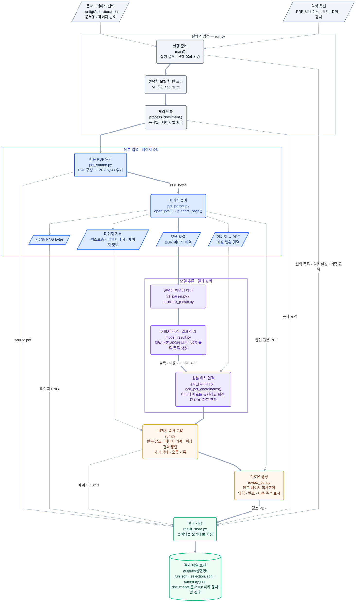

# MMDocIR Multimodal RAG

PDF의 텍스트·표·수식·그림을 원본 위치와 연결하고, 검색 결과의 실패 원인을 분석하는 학습·연구 프로젝트다.
현재 범위는 파싱부터 검색·평가까지이며 답변 생성은 포함하지 않는다.

```text
인덱싱: PDF → 파싱·검증 → 청킹 → 임베딩 → 저장·인덱싱
검색: 질문 → 채널별 후보 검색 → 공통 후보 매핑 → 결합 → 리랭킹 → Top 3
평가: 정답 누락·무관한 결과·최초 실패 단계 기록
```

## 현재 상태

| 항목 | 상태 |
|---|---|
| 입력 | 영어 PDF 9개 문서·27페이지의 특성별 표본 |
| 파싱 | PaddleOCR-VL v1.6 주 경로·PP-StructureV3 비교 경로, 좌표 연결·저장·실행 코드 |
| 실행 연결 | VL의 `parser_options()`·`build_parser()` 인자를 `run.py`와 맞추고 공통 추론 모듈 사용 |
| 검증 | 모델 없는 모의 결과·PDF 텍스트 추출·회전·CropBox 좌표 검증 수행 |
| 실제 실행 | 기존 VL 실행의 27페이지 처리 기록: `ok` 26개·`partial` 1개. 처리 상태이며 품질 판정이 아님 |
| 추가 실행 | 3M 9페이지 VL 파싱 완료(`ok`). 기존 문서 폴더에 JSON·PNG를 추가하고 검토 PDF를 8·9·15페이지로 갱신 |
| Structure 실행 | PP-StructureV3 27페이지(3M 8·9·15 포함) 처리 기록: `ok` 27개, CPU 약 3.4시간. 처리 상태이며 품질 판정이 아님 |
| 품질 검토 | 2026-10-30 선정 27페이지의 이미지·JSON 정성 비교. 반복·원문에 없는 내용, 문장–bbox 불일치, 표 행·열 대응 오류 확인. 정확도 점수는 미측정 |
| 남은 확인 | VL 영역 병합 옵션 비교, 반복·환각 식별, 문장 위치 복구와 표 구조 검증. 개선 재실행은 미수행 |
| 규칙 검사 구현 | `parsing.validate_run`: 입력 해시·ID·좌표·반복·병합 그룹·표 격자 검사. 테스트 20개와 실제 54페이지 실행 확인. 원문 의미 정확도는 미측정 |
| 이후 단계 | 청킹·임베딩·인덱스·검색·리랭킹·Recall@3 평가는 미구현 |

이전 PyMuPDF 실행은 8개 문서·24페이지 기록이다. 현재 27페이지나 새 모델 파이프라인의 검증 결과로 취급하지 않는다.
선정 목록은 [configs/selection.json](configs/selection.json), 문서별 관찰은 [DATA_SPEC.md](docs/DATA_SPEC.md)에 기록했다.
`3M_2018_10K`의 대상은 8·9·15페이지로 정정했다. 기존 VL 실행의 7·8·15페이지 기록은 보존하고,
9페이지만 추가할 때는 [configs/selection_3m_page9.json](configs/selection_3m_page9.json)을 사용한다.
추가 결과는 기존 실행의 `documents/<문서 ID>/`에 보관했다. 이 문서의 `review_vl.pdf`는
8·9·15페이지 통합 검토본이며, 페이지별 bbox는 각각 6·19·18개다. 별도 추가 실행 폴더는 남기지 않았다.
추가 실행 조건은 `page_00009_run.json`, 현재 검토 대상은 `document.json`과 `review_pages_8_9_15.json`에 기록했다.
실행 루트의 `run.json`·`summary.json`은 최초 실행 기록으로 보존하므로 추가 실행의 전체 요약으로 읽지 않는다.
페이지 번호는 PDF 뷰어의 첫 페이지를 1로 센다. 실제 데이터셋 revision·공식 ID·관련성 라벨 매핑은 미확인이다.

PP-StructureV3 비교 경로를 다시 복구했다. 이전 27페이지 실패 기록과 이번 재실행을 구분한다.
두 결과를 자동으로 합치거나 한 파서를 정답 판정기로 쓰지 않고 원본 PDF와 대조한다.

[파싱 평가와 개선 실험](docs/PARSING_REVIEW.md)에 평가 범위·근거 파일·문서별 관찰,
검토 방법과 한계, 모델 내부 흐름, 다음 실험을 정리했다.
2026-11-02 코드 확인에서 VL의 `merge_layout_blocks=True`와 병합 그룹을 확인했다.
라이브러리가 여러 영역 이미지를 합쳐 읽고 개별 bbox를 유지하는 동작은 문장–bbox 불일치의 유력한 발생 경로다.
병합 비활성화의 개선 효과는 아직 검증하지 않았다. 기존 실행 JSON과 모델 코드는 변경하지 않았다.

[파싱 품질 검증 단계 계획](docs/PARSING_VALIDATION_PLAN.md)은 위 검토 절차를 VL·Structure 뒤에 적용하는 설계안이다.
규칙 검사·원본 근거 정렬·선택적 시각 검토·재인식·청킹 전달 정책과 완료 기준을 정리했다.
첫 규칙 검사 코드는 구현해 실행했고, 추가 모델 호출·문장 위치 복구·표 의미 대응 검증은 아직 미구현이다.

## 구조와 코드 읽는 순서

```text
.
├─ configs/selection.json
├─ parsing/
│  ├─ pdf_source.py        # 1. 선택 목록·HTTP 입력
│  ├─ pdf_parser.py        # 2. PDF 추출·렌더링·좌표 변환
│  ├─ model_result.py      # 3. 공통 추론·JSON·영역 변환
│  ├─ v1_parser.py         # 4. PaddleOCR-VL 설정과 호출
│  ├─ structure_parser.py  # 5. PP-StructureV3 설정과 호출
│  ├─ review_pdf.py        # 6. 원문 복사본 위 bbox 표시
│  ├─ result_store.py      # 7. JSON·PDF·PNG 저장
│  ├─ run.py               # 8. 실행 진입점
│  ├─ quality_checks.py    # 저장된 페이지의 순수 규칙 검사
│  ├─ validate_run.py      # 검사 실행·입력 조회·별도 보고서 저장
│  └─ __init__.py
├─ docs/
│  ├─ DATA_SPEC.md
│  ├─ PROJECT_PLAN.md      # 설계·기술 선정 근거·실험 계획
│  ├─ PARSING_REVIEW.md    # 파싱 품질 관찰·평가 근거·개선 실험
│  ├─ PARSING_VALIDATION_PLAN.md # 파싱 뒤 품질 검증 단계 구현 계획
│  └─ RAG_LEARNING_PLAN.md # 기본 학습 커리큘럼
├─ requirements.txt
├─ tests/test_parsing_quality.py # 규칙 경계·CLI·원본 보존 검증
└─ outputs/
```

실행은 `run.py`에서 시작한다. PyMuPDF로 입력을 준비하고 선택한 파서 하나로 페이지 이미지를 파싱한다.
VL과 Structure는 별도 프로세스·결과 폴더로 실행해 출력과 모델 메모리를 구분한다.

### 모듈 호출과 입출력 흐름

다음은 `run.py`의 호출 구조다. 파서별 설정과 초기화는 각 어댑터에서 담당하고,
이미지 추론·원본 JSON·공통 영역 정리는 `model_result.py`에서 처리한다.



색상은 실행 제어(회색)·페이지 준비(파랑)·모델 처리(보라)·결과 통합과 검토(주황)·저장(초록)을 구분한다.
도형은 역할을 나타낸다. 평행사변형은 입력·전달 데이터, 둥근 사각형은 처리, 원통형은 결과 파일 보관을 뜻한다.
굵은 화살표는 핵심 처리 경로, 가는 화살표는 설정·보조 데이터 전달과 개별 결과 저장을 나타낸다.

이 그림은 모듈의 책임과 데이터 흐름을 나타낸다. 저장은 마지막에 한 번만 수행하지 않는다.
원본 PDF·PNG·페이지 JSON은 준비되는 대로 저장하고, 문서 처리가 끝나면 검토 PDF와 문서 요약을 남긴다.
전체 실행이 끝나면 `summary.json`을 저장한다.
PDF에서 직접 추출한 텍스트층과 모델 인식 결과는 따로 보존하며, 모델에는 페이지 이미지를 입력한다.

## 실행 환경

- 개인 Coder 컨테이너: CPU 4코어·RAM 16GB. 공용 서버의 GPU·VRAM 할당은 미확인이다.
- 모델 없는 검증 환경: Windows·PowerShell·Python 3.14.8.
- 기존 VL 실제 실행 환경: Windows·Python 3.12.14·PaddleOCR 3.7.0·PaddleX 3.7.2·PaddlePaddle 3.3.1 CPU.
- [requirements.txt](requirements.txt)에 의존성을 기록했다. GPU 실행은 미검증이며, GPU에는 대응 Paddle 패키지와 드라이버가 필요하다.

아래 명령은 프로젝트 루트의 Bash 기준이다. Windows에서는 Git Bash나 WSL 환경에 맞춰 Python 경로를 확인한다.
실제 파싱 전에 PDF 폴더를 제공하는 HTTP 서버와 추론 환경을 준비해야 한다.
기존 PDF 주소는 `http://127.0.0.1:8080/raw/mmdocir_data/extracted/doc_pdfs/`이며,
`127.0.0.1`은 실행 중인 컴퓨터·컨테이너 자신을 뜻한다.

## 파싱 실행

### 실행 전 확인

`parser_options(device, cpu_threads)`는 모델을 로딩하지 않고 설정 딕셔너리를 반환한다.
`build_parser(device, cpu_threads)`는 이 설정으로 모델을 초기화한다.
VL의 JSON 목록 변환과 시간 측정은 공통 모듈을 사용한다. 기존 결과의 정성 검토에서 결함을 확인했으며,
정확도 측정과 개선 설정의 재실행은 아직 수행하지 않았다.

필요한 패키지와 버전은 [requirements.txt](requirements.txt)에 기록했다.
선택한 Python·운영체제·아키텍처에서 패키지를 지원하는지 확인하고, 의존성 준비와 파싱 실행에 같은 Python을 사용한다.

PDF 서버도 먼저 준비한다. `--base-url`과 문서명을 합친 URL에서 PDF 파일을 직접 읽을 수 있어야 한다.
로그인 화면이나 HTML 페이지를 반환하는 주소는 PDF 입력으로 사용할 수 없다.
설치 방식과 Python 지원 범위는 [PaddleOCR-VL 공식 실행 안내](https://www.paddleocr.ai/main/en/version3.x/pipeline_usage/PaddleOCR-VL.html)를 참고한다.

### 실행 명령

도움말은 모델 로딩·다운로드·결과 파일 생성을 하지 않는다.

```bash
python -B -m parsing.run --help
```

주 파싱 경로의 실행 예시다. 모델 초기화 시 다운로드·캐시가 생길 수 있고, 원본 PDF를 HTTP로 읽어 새 출력 폴더를 만든다.
같은 출력 폴더가 이미 있으면 덮어쓰지 않고 실패한다. CPU 예시는 처리 속도나 16GB 내 동작을 보장하지 않는다.

```bash
python -B -m parsing.run \
  --base-url http://127.0.0.1:8080/raw/mmdocir_data/extracted/doc_pdfs/ \
  --parser vl --device cpu --dpi 144 \
  --output-dir outputs/parsing_vl_01
```

선정한 문서의 전체 페이지를 처리하려면 `--all-pages`를 붙인다. 문서 목록과 원본 선택 설정은 바뀌지 않는다.
중단 후 자동 재개는 미구현이며 다시 실행할 때 새 출력 폴더를 지정한다.

PP-StructureV3는 다음 명령으로 실행한다. 문자 OCR은 PP-OCRv6 medium,
수식은 비교 후보인 `PP-FormulaNet_plus-L`을 사용한다. 이 선택이 VL보다 정확하다는 실측 결론은 아니다.

```bash
python -B -m parsing.run \
  --base-url http://127.0.0.1:8080/raw/mmdocir_data/extracted/doc_pdfs/ \
  --parser structure --formula-model PP-FormulaNet_plus-L \
  --device cpu --cpu-threads 4 --dpi 144
```

## 결과 확인

실행 폴더는 다음 구조로 저장된다. 저장소에는 `outputs/`의 JSON·PNG·검토 PDF(`review_*.pdf`)를 올린다.
원본 `source.pdf`는 `.gitignore`의 `*.pdf` 규칙에 따라 로컬에만 둔다.

```text
outputs/<실행명>/
├─ run.json                  # 환경·설정·코드·선정 목록 해시
├─ selection.json            # 입력 선택 목록 복사본
├─ summary.json              # 문서·페이지 상태와 오류
└─ documents/<문서명 SHA-256>/
   ├─ source.pdf             # HTTP로 받은 원본 bytes
   ├─ document.json          # 원본 해시·페이지와 결과 경로
   ├─ page_00009.png         # 페이지 렌더링
   ├─ page_00009.json        # 원본 추출·모델 출력·영역·좌표
   └─ review_vl.pdf          # Structure 실행이면 review_structure.pdf
```

먼저 `summary.json`에서 실패·부분 실패를 확인하고, 페이지 JSON과 검토 PDF를 대조한다.
`ok`·`empty`는 처리 상태이며 정확성·완전성 판정이 아니다.
검토본의 파란 테두리는 모델 bbox, 숫자는 모델 결과 목록의 순번이다. 주석에 요소 ID·추출 내용·JSON 경로를 남긴다.
번호가 올바른 읽기 순서를 보장하지는 않는다.

문서별 `review_vl.pdf` 또는 `review_structure.pdf`에서 선택한 파서의 영역과 내용을 원본과 대조한다.
비교할 때 원본 PDF 해시·페이지·DPI·PNG 해시가 같은지 확인한다.
페이지 PNG에는 bbox를 덧그리지 않는다. bbox는 원본 페이지를 복사한 검토 PDF에 표시한다.
표시 단위는 모델이 반환한 텍스트·표·수식·그림 등의 레이아웃 영역이다. 단어별·표 셀별 상자를 따로 그리는 기능은 포함하지 않는다.
이미지 픽셀 좌표와 PDF 좌표는 페이지 JSON의 `parsing.blocks`에 함께 보존한다.

## 저장 결과의 규칙 검사

`parsing.validate_run`은 현재 선정 목록의 문서·페이지를 읽는다. 파싱 모델을 로딩하지 않고
표준 라이브러리로 입력 해시·ID·좌표 변환, 반복·긴 번호 나열, VL 병합 그룹, HTML 표 격자를 검사한다.
추론 파이프라인과 별도 실행하며 기존 raw·페이지 JSON·PNG·요약은 수정하지 않는다.

프로젝트 루트의 Bash 기준 명령이다. 기본 실행은 요약을 콘솔에만 출력하고 파일·캐시를 생성하지 않는다.

```bash
python3 -B -m parsing.validate_run \
  --run-dir outputs/parsing_vl_20261027T015138481163Z

python3 -B -m parsing.validate_run \
  --run-dir outputs/parsing_structure_20261028T232222203813Z
```

선정 목록 기본값은 `configs/selection.json`, 원본 PDF 폴더는 `data/doc_pdfs`다.
다른 환경에서는 `--selection`, `--pdf-dir`로 지정한다. 원본 PDF가 없으면 해시 검증을 `unresolved`로 남긴다.
3M의 현재 대상은 8·9·15페이지이며 과거 7페이지는 자동 포함하지 않는다.

상세 보고서를 저장하려면 `--output outputs/quality_vl_01.json`을 추가한다. 이는 새 JSON 하나를 생성한다.
입력 실행 폴더 안에는 저장할 수 없고, 기존 파일을 덮어쓰거나 부모 폴더를 자동 생성하지 않는다.
보고서에는 규칙 버전·임계값·검사 코드 해시·입력 해시·요소 ID·근거를 기록한다.
종료 코드 0은 검사 실행 완료, 2는 실행 인자·보고서 저장 등 실행 오류를 뜻한다. 0이 품질 통과를 뜻하지 않는다.

2026-11-02 macOS·Python 3.12.10에서 실제 파일로 실행한 결과다.

| 경로 | 검사 페이지 | 검토 후보 페이지 | 검사 신호 |
|---|---:|---:|---|
| VL | 27 | 13 | 병합 그룹 22·긴 번호 나열 2·단어 집중 반복 1·3단어 묶음 반복 1·출력 길이 1 |
| Structure | 27 | 4 | 긴 번호 나열 1·표 격자 3 |

한 페이지에 여러 신호가 있을 수 있다. 검토 후보 수는 실제 오류율이나 파서 우열이 아니다.
해시·좌표 계산·ID 등의 확정 오류는 이 입력에서 발견하지 못했고, 검사 전후 기존 출력과 원본 PDF 163개 파일의 해시가 일치했다.
검사 코드·원본 보존·보고서 배타적 저장의 경계 테스트 20개도 통과했다.

```bash
python3 -B -m unittest discover -s tests -v
```

테스트는 정리되는 임시 폴더에 작은 입력과 보고서를 만든다. 실제 파싱 결과는 수정하지 않는다.
`suspected`는 원본 대조가 필요한 신호, `unresolved`는 확인하지 못한 항목이다.
신호가 없는 페이지도 `not_reviewed`로 남기며 정확하다고 판정하지 않는다.
표 격자가 정상이어도 숫자가 잘못된 행에 있을 수 있다. 원문 줄·셀 정렬과 개선 모델 재실행은 이후 단계다.
VLM/API 검토는 선택지로 유지하며 현재 검사에는 사용하지 않는다.

## 문서와 작업 방식

| 문서 | 역할 |
|---|---|
| [PROJECT_PLAN.md](docs/PROJECT_PLAN.md) | 모델·프레임워크 선정 근거, 내부 구조·대안, 세 채널 결합·리랭킹·평가 설계, 다음 실험 |
| [DATA_SPEC.md](docs/DATA_SPEC.md) | 선정 문서·페이지·관찰 특성 |
| [PARSING_REVIEW.md](docs/PARSING_REVIEW.md) | 27페이지 정성 평가·구조 검사, 평가 방법·한계, 반복·위치·표 개선 실험 |
| [PARSING_VALIDATION_PLAN.md](docs/PARSING_VALIDATION_PLAN.md) | 공통 품질 검증 단계의 입력·출력, 규칙·원본 대조·재인식, 지표·완료 기준 |
| [RAG_LEARNING_PLAN.md](docs/RAG_LEARNING_PLAN.md) | 별도로 보존하는 기본 학습 커리큘럼 |
| [AGENTS.md](AGENTS.md) | 탑다운 학습, 코드·주석·글쓰기, 파일 변경·커밋·푸시 규칙 |

현재 범위의 전체 코드를 먼저 보고 주석을 따라 이해·실행·수정한다.
전체 데이터 흐름과 실제 코드의 입력·출력 예시를 먼저 확인하고, 상세 설명은 실행 진입점부터 호출 순서대로 나눠 진행한다.
실제 실행 결과와 설명용 예시는 구분한다.
커밋은 dev 브랜치에 하고, 명시적인 승인을 받은 뒤 `origin/dev`에 푸시한다. main에는 GitHub 풀 리퀘스트에서 스쿼시 머지로 합친다.
원격 주소는 임의로 바꾸지 않으며 명시적인 승인 전에는 푸시를 포함한 원격 쓰기를 하지 않는다.
