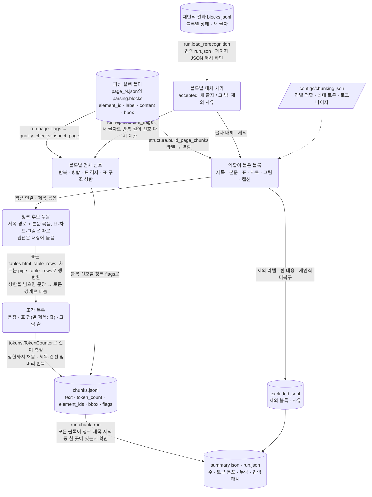
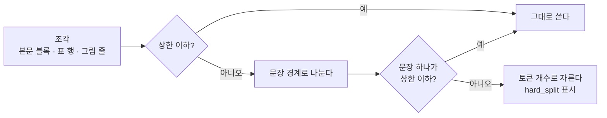

# 구조 기반 청킹

작성일: 2026-11-10. 재파싱·재인식 결과로 입력 변경: 2026-11-11. 설계 문서와 실행 기록 분리: 2026-11-12.

```text
PDF → 파싱 → 청킹〔현재〕 → 임베딩 → 인덱스 → 검색·평가
```

- 구현 코드: [chunking/run.py](../../chunking/run.py)(진입점·입출력), [structure.py](../../chunking/structure.py)(페이지별 청크 생성),
  [tables.py](../../chunking/tables.py)(표 변환), [tokens.py](../../chunking/tokens.py)(토큰 측정·분할)
- 설정 파일: [configs/chunking.json](../../configs/chunking.json)
- 실행 기록: [청킹 기록 타임라인](log/README.md)

파싱 결과의 레이아웃 블록을 검색 단위 청크로 나눈다. 청크마다 원래 블록 ID·페이지·PDF 좌표·
입력 페이지 JSON 해시를 남겨, 검색 결과에서 원문 위치로 돌아갈 수 있게 한다.

## 1. 결정 사항과 이유

| 항목 | 결정 | 이유·한계 |
|---|---|---|
| 분할 방식 | 구조 기반 하나 | 2026-11-10 프로젝트 결정. 기본 커리큘럼의 "고정 길이 vs 구조 기반" 비교는 하지 않는다. 비교 기준선이 없으므로 구조 기반이 고정 길이보다 낫다고 주장하지 않는다 |
| 청크 경계 | 한 페이지 안 | 선정 페이지가 연속하지 않아(예: 3·4·6쪽) 페이지를 넘는 문맥을 확인할 수 없다 |
| 입력 | 병합 해제 재파싱의 VL·Structure 실행 둘 다 + VL 재인식 결과 | 같은 설정으로 두 파서 결과의 청크 수·길이·제외 블록을 비교한다. 2026-11-11에 기준 파싱 실행에서 바꿨다 |
| 표 표현 | 행별 "열 제목: 값" + 원본 HTML 보존 | 값마다 열 제목을 붙여 조각만 봐도 숫자의 의미가 남게 한다. 원본은 `table.source_content`에 둔다 |
| 길이 측정 | Qwen3-Embedding-8B 토크나이저 | 텍스트 임베딩 우선 후보. 실제 임베딩 입력과 같은 기준으로 세려고 토크나이저 파일만 받고 가중치는 받지 않았다 |
| 생성 한도에 닿은 VL 블록 | 재인식 글자로 바꾸거나, 복구하지 못하면 청크에서 빼고 사유를 남긴다 | 2026-11-11 결정. 한도에서 잘린 반복 출력은 원문이 아님을 확인했다([VL 생성 한도 반복](../parsing/log/2026-11-11_vl.md#4-vlm-영역-인식-생성-한도까지-반복된-출력)). 원문이 아닌 글자를 임베딩하지 않는다. 지우지 않고 `excluded.jsonl`에 남겨 누락이 드러나게 한다 |
| 그 밖의 반복·이상 신호 | 청크로 만들고 신호만 표시 | 원문일 가능성이 남아 있어 지우면 근거까지 잃을 수 있다. 크기 통계는 신호 없는 청크(`unflagged`)를 따로 집계한다 |
| 재인식 결과 적용 조건 | 입력 실행 `run.json` 해시가 같을 때만 적용, 재인식 뒤 페이지 JSON이 바뀌었으면 실행 중단 | 폴더 이름만 같고 내용이 다른 실행에 엉뚱한 결과를 덮어쓰지 않기 위해서다 |

## 2. 데이터 흐름

노드는 데이터, 화살표는 그 데이터를 바꾸는 함수다. 원통은 파일로 저장되는 데이터, 둥근 사각형은 메모리에만 있는 중간 데이터다.



### 2.1 처리 단계

1. **역할 분류**: 라벨을 제목(단계별)·본문·표·차트·그림·캡션·제외로 나눈다. 설정에 없는 라벨은 본문으로 다루고
   `unmapped_labels`에 센다. 내용이 빈 블록은 `empty_content`, 머리글·바닥글·쪽 번호는 `excluded_label`로 남긴다.
2. **캡션 연결**: 캡션을 세로 간격이 가장 가까운 표·차트·그림에 붙인다. 간격이 설정값을 넘으면 본문으로 다룬다.
3. **제목 묶음**: 블록 순서대로 걸으며 제목이 바뀔 때 본문 묶음을 끊는다. 상위 제목이 바뀌면 하위 제목을 지운다.
   표·차트·그림은 별도 청크다. 모든 청크 앞에 `상위 제목 > 하위 제목`을 붙인다.
4. **길이 맞추기**: 아래 2.2절.
5. **누락 확인**: 모든 블록이 청크 내용·제목 문맥·제외 기록 중 한 곳에 있는지 대조한다(`blocks.unassigned`).

재인식 결과는 1단계에서 적용한다. 원래 페이지 JSON은 바꾸지 않는다.

- `accepted` 블록: 재인식 글자로 청크를 만든다. 원래 글자로 계산한 반복·길이 신호는 지우고 새 글자로 다시 계산한다.
  좌표·병합 같은 다른 신호는 글자와 관계없어 그대로 둔다.
- `unresolved`·`skipped_unsupported_label` 블록: 청크에서 빼고 `excluded.jsonl`에
  `generation_limit_unrecovered`·`generation_limit_not_rerecognized`와 재인식 근거를 남긴다.

뒤따르는 내용이 없어 어떤 청크의 제목 문맥으로도 쓰이지 않은 제목은 단독 청크로 남기고 `title_only`로 표시한다.

### 2.2 길이 맞추기와 강제 분할

청크가 최대 토큰(`max_tokens`)을 넘으면 의미가 덜 깨지는 경계부터 차례로 나눈다.

| 순서 | 본문 | 표·차트 | 그림 |
|---|---|---|---|
| 1 | 블록 단위 | 행 단위 | 줄 단위 |
| 2 | 영어 문장 경계(마침표·물음표·느낌표 뒤 공백 다음에 대문자·숫자·여는 기호) | 같음 | 같음 |
| 3 | 토큰 경계(`hard_split` 표시) | 같음 | 같음 |

판단 순서(데이터 흐름이 아니라 조각 하나를 나누는 규칙)다.



- 나눈 조각마다 제목·캡션·종류 표시(`[Table]` 등)를 반복한다. 조각만 검색돼도 무엇의 일부인지 알 수 있게 하기 위해서다.
- 3순위가 있는 이유: 정한 청크 크기 상한을 모든 청크가 지키게 하기 위해서다. 문장 하나가 상한보다 길면 경계로는
  더 나눌 수 없으므로 마지막 수단으로 토큰 개수 단위로 자른다. 자른 조각은 원문의 연속 부분 문자열이다.
  상한 512는 임베딩 모델의 위치 한도(40,960)가 아니라 검색 단위 크기로 정한 시작값이다(3절).
- `hard_split`은 오류가 아니라 "자연스러운 경계가 없는 글"이라는 신호다. 마침표 없이 같은 단어가 이어진 반복 출력도
  여기까지 내려온다. 강제 분할이 많으면 입력 글자부터 확인한다.

## 3. 설정값

[configs/chunking.json](../../configs/chunking.json)이 원본이다. 상대 경로는 설정 파일 폴더 기준이다.

| 필드 | 현재 값 | 의미·선택 이유 |
|---|---|---|
| `input_runs` | VL·Structure 재파싱 실행(2026-11-10·11) | 청킹할 파싱 실행 폴더. `--input-run`으로 바꿀 수 있다 |
| `rerecognition_runs` | `rerecognition_vl_20261111T101144801007Z` | 적용할 재인식 결과. 입력 실행의 `run.json` 해시가 같을 때만 쓴다 |
| `selection` | `selection.json` | 처리할 문서·페이지. 3M은 8·9·15쪽 |
| `tokenizer.repo_id`·`revision` | `Qwen/Qwen3-Embedding-8B`·`1d8ad4ca9b3d…` | 2026-11-10 조회한 저장소 최신 commit으로 고정 |
| `tokenizer.add_special_tokens` | `true` | 문서 입력 끝에 붙는 `<|endoftext|>`까지 센다 |
| `max_tokens` | 512 | 계획의 256/512/1024 후보 중 시작값. 검색 품질로 정한 값이 아니다 |
| `overlap_tokens` | 0 | 겹침 없이 시작. 문장·행 단위로만 겹친다 |
| `caption_max_gap_points` | 72 | 캡션–대상 세로 간격 한도(PDF point, 1인치). 측정으로 정한 값이 아니다 |
| `table_header_rows_without_th` | 1 | `<th>`가 없는 표에서 헤더로 볼 앞 행 수 |
| `kind_markers` | `[Table]`·`[Chart]`·`[Figure]`·`Caption:` | 청크 텍스트 안 종류 표시. 임베딩 입력에 들어간다 |
| `labels` | 두 파서 결과에서 관찰한 라벨만 | 다른 라벨은 본문으로 처리하고 따로 센다 |
| `flag_rules` | 반복·번호 나열·길이·병합 그룹·표 격자·표 구조 상한 | 청크에 표시할 파싱 검사 신호 |

## 4. 실행

```bash
.venv/bin/python -B -m chunking.run --check   # 설정·입력 확인. 다운로드·파일 생성 없음
.venv/bin/python -B -m chunking.run           # 입력 실행마다 새 청킹 폴더 생성
```

처음 실행하면 토크나이저(`tokenizer.json` 11.4MB)와 `config.json`을 Hugging Face 캐시에 내려받는다.
입력 파싱 결과는 읽기만 하고, 출력 폴더는 매번 새로 만든다. 선정 페이지가 입력에 없거나 블록이 빠지면
종료 코드 1과 `completed_with_problems`로 알린다.

## 5. 출력 형식

`outputs/chunking_<파서>_<UTC>/`에 네 파일을 만든다. 쓰는 코드는 [chunking/run.py](../../chunking/run.py)와
[structure.py](../../chunking/structure.py)다. 이 형식을 읽는 다음 단계 코드는 아직 없다(임베딩 미구현).

| 파일 | 내용 |
|---|---|
| `run.json` | 설정 내용·해시, 입력 실행 경로와 `run.json` 해시, 적용한 재인식 결과, 선정 목록 해시, 토크나이저 출처, 규칙 검사 버전, 코드 해시, 환경 |
| `chunks.jsonl` | 청크 한 줄에 하나 |
| `excluded.jsonl` | 청크에 넣지 않은 블록 한 줄에 하나. `element_id`·`label`·`page_id`·`page_json`·`reason`·`characters`, 재인식으로 뺀 블록은 `rerecognition` |
| `summary.json` | 페이지·블록·청크 수, 토큰 분포, 제외 사유별 수, 재인식 적용 수, 캡션·제목 단독·강제 분할 수, 페이지별 통계 |

`chunks.jsonl`의 필드:

| 필드 | 타입 | 뜻 |
|---|---|---|
| `chunk_id` | 문자열 | `<page_id>:<vl\|structure>:chunk:<페이지 안 순번>`. 프로젝트가 만든 값(`id_origin: project_generated`) |
| `kind` | 문자열 | `text`·`table`·`chart`·`visual` |
| `document_id`·`document_name`·`page_id`·`page_number` | 문자열·정수 | 파싱 페이지 JSON의 값을 그대로 옮긴다 |
| `text` | 문자열 | 임베딩에 넣을 글자. 제목 경로·캡션·종류 표시를 포함한다 |
| `token_count` | 정수 | `text`의 토큰 수(끝 토큰 포함) |
| `heading`·`heading_element_ids` | 문자열·목록 | 붙인 제목 경로와 그 제목 블록 ID |
| `element_ids`·`caption_element_ids` | 목록 | 청크 내용에 들어간 블록 ID, 붙인 캡션 블록 ID |
| `blocks` | 목록 | 블록마다 `element_id`·`label`·`role`·`bbox_pdf_points`·`bbox_image_pixels`·`content_source`(`parsing`·`rerecognition`). 재인식 글자면 `rerecognition`에 결과 폴더·상태·DPI·원래 출력 해시·새 글자 해시 |
| `flags` | 목록 | 파싱 검사 신호와 청킹 신호(`hard_split`·`title_only` 등) |
| `split` | 객체 | 한 블록·묶음을 나눈 조각의 `index`·`count` |
| `table` | 객체 | 표·차트 청크만. `format`·`headers`·`row_count`·`piece_rows`·`empty_cells`·`image_cells`·`source_content`(원본 HTML) |
| `source` | 객체 | 입력 `page_json` 경로·해시, 페이지 상태, 신호 계산 상태 |

정답 답변과 관련성 레이블은 청크에 넣지 않는다.

## 6. 알려진 한계

- `<th>` 없이 헤더가 두 줄인 표는 둘째 헤더 줄이 데이터 행이 된다. 예: VL 3M 15쪽 표의
  `December 31, 2018 / 2018 / 2017` 줄. 규칙으로 안정적으로 구분하기 어려워 설정값(1행)으로 둔다.
- 표 변환은 파서가 만든 표 구조를 그대로 따른다. Structure의 3M 15쪽처럼 값이 다른 행으로 옮겨진 표는 청크에서도 틀린다.
- 문장 분할은 영어 규칙이다. `e.g.` 같은 약어에서 잘못 나눌 수 있다.
- 읽기 순서는 파서가 돌려준 블록 순서를 따른다. 다단 본문에서 순서가 틀리면 제목 묶음도 틀린다.
- 청크가 검색 정답 근거를 보존하는지(핵심 근거 보존)는 질의·정답 라벨이 없어 아직 측정하지 않았다.
- 실행 기록은 청킹 폴더의 `run.json`에 남기며 `experiments`의 공통 기록기·자동 비교와는 아직 연결하지 않았다.
- 재인식으로 바꾼 글자도 완전한 원문은 아니다. Toyota p7은 영어 라벨과 일본어 아래쪽 상자만 나왔다.
- 복구하지 못해 뺀 블록은 원래 출력에 맞는 글자가 일부 있어도 함께 빠진다(`excluded.jsonl`에서 확인).
- Structure 슬라이드 p6 차트의 지어낸 값과 RAG p6 표 마지막 행은 신호만 붙이고 그대로 둔다
  ([차트 환각](../parsing/log/2026-11-11_structure.md#4-차트-인식-연표-그림을-표로-바꾸며-값을-지어냄),
  [표 구조 토큰 상한](../parsing/log/2026-11-11_structure.md#31-구조-토큰-상한에서-잘려-마지막-행에-여러-행이-합쳐짐)).
- 재인식 결과 적용은 파일 해시로 판정하므로 줄바꿈이 바뀐 작업 사본에서는 실패한다
  ([CRLF 해시 불일치](../environment/log/2026-11-11_windows-crlf-hash-mismatch.md)).

## 7. 현재 상태

최신 실행은 2026-11-11 묶음이다([VL](log/2026-11-11_vl.md), [Structure](log/2026-11-11_structure.md)).
VL 170개·Structure 147개 청크이고 미배정 블록과 512토큰 초과 청크는 없다.
