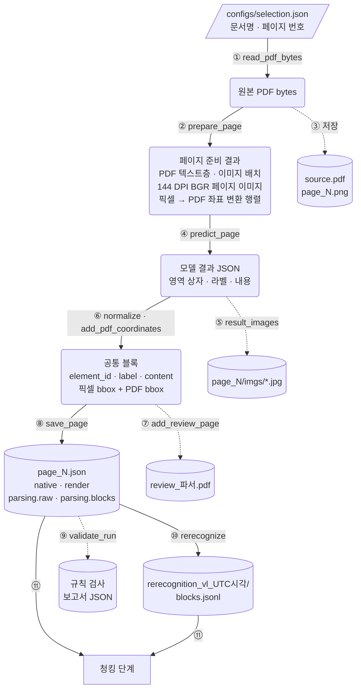

# 파싱

작성: 2026-11-12. 흩어져 있던 파싱 설계 결정을 모으고 기록 문서로 링크한다.

```text
PDF → 파싱〔현재〕 → 청킹 → 임베딩 → 인덱스 → 검색·평가
```

- 구현 코드: [parsing/](../../parsing/). 모듈별 역할과 호출 순서는 루트 [README의 구조와 코드 읽는 순서](../../README.md#구조와-코드-읽는-순서)에 있다.
- 설정 파일: [configs/parsing_run.json](../../configs/parsing_run.json)(입력·파서·장치·DPI·출력),
  [configs/experiment_recording.json](../../configs/experiment_recording.json)(`pipeline_options`·`predict_options` 덮어쓰기),
  [configs/selection.json](../../configs/selection.json)(문서·페이지), [configs/rerecognition.json](../../configs/rerecognition.json)(재인식)
- 실행 기록: [파싱 기록 타임라인](log/README.md)
- 검증 계획: [파싱 품질 검증 단계 계획](../planning/PARSING_VALIDATION_PLAN.md)

PDF 페이지를 이미지로 렌더링해 레이아웃 파서로 영역(블록)별 내용을 얻고, 각 블록에 이미지 좌표와 PDF 좌표를 붙여 저장한다.
PDF 텍스트층은 모델 결과와 따로 보존해 대조 자료로 쓴다.

## 1. 데이터 흐름

노드는 데이터, 화살표는 그 데이터를 바꾸는 함수다. 원통은 파일로 저장되는 데이터, 둥근 사각형은 메모리에만 있는
중간 데이터다. 가운데 줄기가 주 흐름이고, 옆으로 나간 원통은 그 단계에서 함께 저장하는 파일이다.
원통 중 재인식·규칙 검사 결과를 뺀 나머지는 `outputs/parsing_파서_UTC시각/documents/문서 ID/` 아래에 저장된다.
모델 안의 흐름은 모델마다 달라 [VL](log/2026-10-30_vl.md#15-데이터-흐름)·[Structure](log/2026-10-30_structure.md#14-데이터-흐름) 기록에 따로 그렸다.



| 화살표 | 함수 | 하는 일 |
|---|---|---|
| ① | `pdf_source.read_pdf_bytes` | 선정 문서의 PDF를 HTTP 주소나 로컬 폴더에서 읽는다 |
| ② | `pdf_parser.prepare_page` | 텍스트층·이미지 배치를 추출하고, 페이지를 144 DPI로 렌더링해 RGB→BGR 배열로 바꾸고, 좌표 변환 행렬을 만든다 |
| ③ | `run.process_document`·`run.parse_page` | 원본 사본 `source.pdf`(커밋하지 않음)와 RGB 렌더링 PNG를 저장한다 |
| ④ | 어댑터 `parse_image` → `model_result.predict_page` | 페이지 이미지 하나를 모델에 넣어 레이아웃 검출과 영역 인식을 한다 |
| ⑤ | `model_result.result_images` | 결과 객체의 그림 crop(`markdown_images`)을 꺼내 저장한다 |
| ⑥ | `model_result.normalize_result_blocks`·`pdf_parser.add_pdf_coordinates` | 모델 결과를 공통 블록으로 옮기고(내용·픽셀 bbox 그대로), ②의 행렬로 PDF 좌표를 더한다 |
| ⑦ | `review_pdf.add_review_page` | 원본 페이지 사본 위에 블록 bbox와 번호를 표시한다 |
| ⑧ | `run.save_page` | 텍스트층(`native`), 렌더링 정보, 모델 원본(`parsing.raw`), 공통 블록을 한 JSON으로 저장한다 |
| ⑨ | `validate_run.inspect_run` | 저장된 페이지를 읽기만 하고 규칙 신호를 별도 보고서로 낸다 |
| ⑩ | `rerecognize` | 출력이 4,080토큰 이상인 VL 블록만 골라 `source.pdf` 사본에서 그 영역을 576 DPI로 다시 렌더링해 다시 인식한다 |
| ⑪ | `chunking.run` | 페이지 JSON의 블록과 재인식 결과를 함께 읽어 청크를 만든다 |

## 2. 결정 사항과 이유

| 항목 | 결정 | 이유·한계 | 근거 |
|---|---|---|---|
| 파서 | PaddleOCR-VL v1.6 주 경로, PP-StructureV3 비교 경로 | VL은 VLM 기반 인식, Structure는 OCR·표·수식 모듈을 연결한다. 같은 입력의 두 결과를 원본과 각각 대조한다. 어느 쪽이 더 정확하다는 실측 결론은 없다 | [프로젝트 계획](../planning/PROJECT_PLAN.md) |
| 한 실행의 파서 | 하나만. 두 결과를 자동으로 합치지 않음 | 출력과 모델 메모리를 구분한다. 한 파서를 다른 파서의 정답 판정기로 쓰지 않는다 | 프로젝트 계획 |
| 모델 입력 | 페이지 전체 이미지. PDF 텍스트층은 `native`로 따로 보존 | 기록에는 동작만 있고 선택 이유는 적혀 있지 않다. 선정 27페이지 중 7페이지는 텍스트층이 비어 있다. 텍스트층은 대조 자료로 쓴다 | [첫 실행 묶음 VL](log/2026-10-30_vl.md) 1.5·2절 |
| 렌더링 DPI | 144 | 기존 실행 조건을 이어받은 시작값이다. 품질·속도 최적값을 측정하지 않았다. 작은 글자가 있는 그림에서는 부족했다 | 루트 README, [VL 생성 한도 반복](log/2026-11-11_vl.md#4-vlm-영역-인식-생성-한도까지-반복된-출력) |
| VL 영역 병합 | 끔(`merge_layout_blocks=False`, 2026-11-08) | 병합하면 여러 영역의 글자가 첫 블록에 몰리고 bbox는 따로 남는다. 청킹·검색은 bbox로 원문 위치를 찾는다. 상자 경계에서 문장이 나뉘고 VLM 호출 수가 늘 수 있다 | [VL 영역 병합](log/2026-11-11_vl.md#3-레이아웃-영역-병합-해제), `vl_parser.py` |
| VL 그림·차트 인식 | 켬(`use_ocr_for_image_block`·`use_chart_recognition`) | 그림 속 글자와 그래프 값을 얻으려고 공식 기본값(끔)을 바꿨다. 대가로 생성 한도까지 반복하는 블록이 생겼다 | [VL 생성 한도 반복](log/2026-11-11_vl.md#4-vlm-영역-인식-생성-한도까지-반복된-출력) 4.2절, `vl_parser.py` |
| 방향 분류·이미지 보정 | 끔 | 좌표 역변환은 렌더링 원점·배율·PDF 회전만 처리한다. 추가 회전이나 비선형 보정은 되돌리지 못한다. 품질 최적화 결론은 아니다 | `vl_parser.py` |
| 도장 인식 | 끔(공식 기본값 유지) | 선정 PDF에 도장이 없다고 확인한 것은 아니다. 누락이 보이면 전후를 비교한다 | `vl_parser.py`, 프로젝트 계획 |
| VL 내부 큐 | 끔 | 페이지 단위로 결과·오류를 기록하는 추적을 우선한다. 처리량 차이는 측정하지 않았다 | `vl_parser.py` |
| Structure oneDNN | 끔(`enable_mkldnn=False`) | Windows·PaddlePaddle 3.3.1에서 oneDNN 오류로 추론이 실패했다. 호환성 조치이며 품질과 관계없다 | 프로젝트 계획 |
| 처리 상태 | `ok`·`empty`·`partial`·`failed` | 처리 상태이며 품질 판정이 아니다. 문자열이 있으면 `ok`다 | [첫 실행 묶음 VL](log/2026-10-30_vl.md) 1.5절 |
| 규칙 검사 | 별도 실행, 별도 보고서, 원본 결과 수정 없음 | 반복·병합·표 격자 같은 신호는 원문 대조가 필요한 후보다. 신호로 확정 오류를 판정하지 않는다 | [검증 계획](../planning/PARSING_VALIDATION_PLAN.md) |
| 생성 한도 블록 | 끝난 실행의 해당 블록만 576 DPI로 다시 인식, 별도 폴더 저장 | 원래 결과를 덮어쓰지 않는다. 채택은 "반복 없이 스스로 끝남"이며 정확성 보증이 아니다 | [VL 생성 한도 반복](log/2026-11-11_vl.md#4-vlm-영역-인식-생성-한도까지-반복된-출력) 4.3절 |

## 3. 실행

명령, 입력 준비, 실행 부작용은 루트 README에 있다.

- [파싱 실행](../../README.md#파싱-실행)
- [결과 확인](../../README.md#결과-확인)
- [저장 결과의 규칙 검사](../../README.md#저장-결과의-규칙-검사)
- [생성 한도 블록 재인식](../../README.md#생성-한도-블록-재인식)

## 4. 출력 형식

페이지 JSON의 필드, ID 규칙, 이미지 좌표와 PDF 좌표의 관계는 루트
[README의 페이지 JSON 필드와 ID·좌표 연결](../../README.md#페이지-json-필드와-id좌표-연결)에 있다.
재인식 결과(`run.json`·`blocks.jsonl`·`crops/`·`summary.json`)의 필드는
[parsing/rerecognize.py](../../parsing/rerecognize.py)의 모듈 설명에 있다.

페이지 JSON의 `parsing.blocks`를 읽는 코드는 다음과 같다. 형식을 바꾸면 함께 확인한다.

| 읽는 코드 | 용도 |
|---|---|
| [chunking/run.py](../../chunking/run.py)·[structure.py](../../chunking/structure.py) | 청크 생성 |
| [parsing/quality_checks.py](../../parsing/quality_checks.py)·[validate_run.py](../../parsing/validate_run.py) | 규칙 검사 |
| [parsing/rerecognize.py](../../parsing/rerecognize.py) | 재인식 대상 선택 |
| [parsing/resume.py](../../parsing/resume.py) | 중단 실행의 저장 페이지 재사용 |
| [experiments/compare.py](../../experiments/compare.py)·[evaluate.py](../../experiments/evaluate.py) | 실행 전후 비교·정답 기반 평가 |

## 5. 알려진 한계

- 정답 전사본이 없어 문자·표·문장 위치 정확도를 측정하지 않았다. 지금까지의 판단은 정성 대조와 규칙 신호다.
- 미해결 문제는 [파싱 기록 타임라인](log/README.md)에서 상태가 "미해결"·"부분 해결"인 기록을 본다.
  VLM 입력 색 순서, Structure 차트 환각, 표 구조 토큰 상한, 표와 목록의 검출 병합, 표 머리글 칸 부족이 있다.
- 수식 첨자 오류(DETR p5), 단어 오인식, 3M 15쪽 표 값의 행 이동 등은 [첫 실행 묶음 기록](log/README.md)에 관찰만 있고 따로 조사하지 않았다.

## 6. 현재 상태

- 최신 파싱 실행: VL [parsing_vl_20261110T233124280038Z](../../outputs/parsing_vl_20261110T233124280038Z),
  Structure [parsing_structure_20261111T073737685789Z](../../outputs/parsing_structure_20261111T073737685789Z)(병합 해제 재파싱)
- 최신 재인식: [rerecognition_vl_20261111T101144801007Z](../../outputs/rerecognition_vl_20261111T101144801007Z)
- 규칙 검사 버전: 0.3.0
