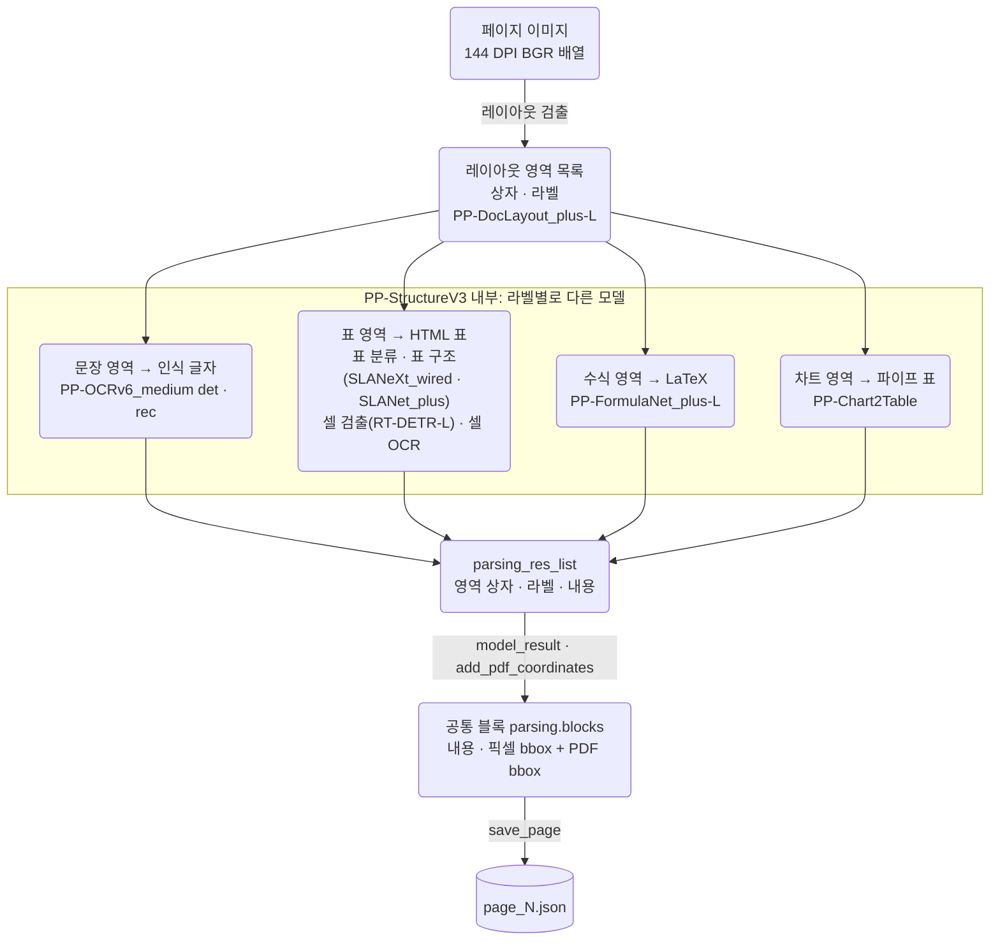

# 첫 파싱 실행 묶음: Structure

- 실행 폴더: [parsing_structure_20261028T232222203813Z](../../../outputs/parsing_structure_20261028T232222203813Z)
- 검토: 최초 정성 검토 2026-10-30, 설치 패키지·저장 결과 추가 확인과 분류 정리 2026-11-02.
  최초 검토 기준 커밋 `3e54d62`, 추가 코드 확인 기준 `dcd6d29`.
- 같은 묶음의 VL 기록: [2026-10-30_vl.md](2026-10-30_vl.md)
- 다음 묶음의 Structure 기록: [2026-11-11_structure.md](2026-11-11_structure.md)
- 출처: `docs/parsing_log/PARSING_REVIEW.md`(커밋 `1655543`)를 모델별로 나눴다. 문장은 원문을 옮기고 위치만 바꿨다.
  두 파서에 공통인 목적·방법·텍스트층·변환 절은 [VL 기록](2026-10-30_vl.md)에 있고 여기서는 링크한다.
  이후에 알게 된 내용은 본문에 섞지 않고 "후속:" 링크로만 달았다.

```text
PDF → 파싱 → 원본 대조·품질 검사〔현재〕 → 청킹 → 임베딩 → 인덱스 → 검색·평가
```

## 이슈 요약

이 기록에서 다룬 이슈다. 상태는 현재 기준이다. 다른 기록에서 해결했거나 원인을 찾은 이슈는 그 기록을 링크했다. 전체 목록은 [파싱 이슈 목록](README.md#이슈-목록)에 있다.

| ID | 모듈 | 이슈 유형 | 케이스 | 현재 상태 | 이 기록의 절 |
|---|---|---|---|---|---|
| P-08 | 영역 인식 | 그림 속 문장이 다른 상자와 섞임 | RAG p3, NUS p9 | 관찰만 | [3](#3-영역-인식문자-ocr-그림-속-문장의-영역-혼합) |
| P-09 | 영역 인식 | 표의 아이콘 셀 정보 누락 | UHD 설명서 p8 | 관찰만 | [3](#3-영역-인식문자-ocr-그림-속-문장의-영역-혼합) |
| P-11 | 표 인식 | 표 값이 다른 행으로 이동 | 3M p15 | 관찰만 | [4](#4-표-인식) |
| P-12 | 표 인식 | 하단 여러 행이 한 셀에 합쳐짐 | RAG 논문 p6 | 표시만([상세](2026-11-11_structure.md#31-구조-토큰-상한에서-잘려-마지막-행에-여러-행이-합쳐짐)) | [4](#4-표-인식) |
| P-13 | 표 인식 | 머리글 병합·체크 표시 오인식 | DETR p13 Table 4 | 미해결([상세](2026-11-11_structure.md#32-머리글-칸-수가-원본보다-하나-적음)) | [4](#4-표-인식) |
| P-14 | 표 인식 | 표 머리글 누락 | 3M 인명·직책 표 | 관찰만 | [4](#4-표-인식) |
| P-17 | 수식 인식 | 첨자 구조 손상 | DETR p5 식 (2) | 관찰만 | [7](#7-두-파서에서-공통으로-관찰된-인식-문제-structure-쪽-근거) |
| P-03 | 레이아웃·인식 | 도식 누락·영역 혼합 | Toyota p21 | 관찰만 | [7](#7-두-파서에서-공통으로-관찰된-인식-문제-structure-쪽-근거) |
| P-02 | 레이아웃 검출 | 조직도·연표 관계 손상(파서 구분 없이 기록) | Toyota p32 | 미해결([상세](2026-11-11_structure.md#2-레이아웃-검출-연표-표와-목록을-표-하나로-묶음)) | [8](#8-문서별-관찰) |
| P-16 | 차트 인식 | 비정상 수치표(파서 구분 없이 기록) | 슬라이드 p6 | 미해결([상세](2026-11-11_structure.md#4-차트-인식-연표-그림을-표로-바꾸며-값을-지어냄)) | [8](#8-문서별-관찰) |

## 1. 실행 개요

### 1.1 목적과 방법

목적, 평가 방법과 한계(원본과 출력의 직접 모순, 출력 자체의 이상, 위치와 내용의 대응, 두 파서의 불일치,
라이브러리·프로젝트 경계 추적)는 VL과 같다. [VL 기록 1.1·1.4절](2026-10-30_vl.md#1-실행-개요)을 본다.

여기서 모델별 구분은 두 파이프라인의 출력 기준이다. Structure 안의 문자 OCR·표·수식·차트 중
어느 모델이 최초 원인인지 확인하지 못한 오류를 PP-OCRv6의 단독 결함으로 단정하지 않는다.

### 1.2 범위와 조건

- [선정 목록](../../../configs/selection.json)의 9개 문서·27페이지를 비교했다.
- 페이지 번호는 PDF 첫 페이지를 1로 센 순번이며 인쇄된 쪽 번호와 구분한다.
- 실행 환경은 Windows·Python 3.12.14·PaddleOCR 3.7.0·PaddleX 3.7.2·PaddlePaddle 3.3.1 CPU·PyMuPDF 1.28.2·NumPy 2.3.5다.
  페이지 렌더링은 144 DPI다.
- `model_weight_revision`은 `null`이다. 모델 이름과 실제 가중치 revision 고정은 별개다.
- 특성별 목적 표본이다. 이 결과를 전체 MMDocIR의 오류율이나 파서의 일반적인 우열로 확대하지 않는다.

Structure의 과거 oneDNN 실행 예외는 인식 품질 문제와 별개다.
어댑터는 그 예외를 피하려고 `enable_mkldnn=False`를 지정하고, 저장된 비교 실행은 27페이지 `ok`다.
실행 완료는 표·문자·수식의 정확성 보장이 아니다.

### 1.3 구조·무결성 검사 결과

| 검사 | 확인 결과 |
|---|---|
| 비교 입력 | VL 실행과 27쌍의 원본 PDF 해시가 서로 같고 로컬 원본 PDF bytes의 SHA-256과 일치 |
| 페이지 이미지 | 27쌍의 기록된 PNG 해시·페이지 형상·native 추출 결과 일치. 각 PNG의 실제 해시도 기록과 일치 |
| 페이지 상태 | `ok` 27 |
| 공통 블록 수 | 384개. 블록 수는 정확도 지표가 아님 |
| 요소 ID | 현재 비교 범위에서 중복 없음 |
| 좌표 계산 | 저장된 이미지→PDF 행렬로 재계산한 bbox가 저장된 PDF bbox와 일치 |
| 내용이 빈 블록 | image 7 |
| 라이브러리 반환값→공통 블록 | 두 실행의 54개 페이지 JSON에서 내용과 이미지 bbox의 변경 없음 |

### 1.4 데이터 흐름

페이지 준비와 저장은 [VL 기록 1.5절](2026-10-30_vl.md#15-데이터-흐름)과 같고, 모델 내부만 다르다.
아래는 기본 설정에 정의된 모듈로 그린 이 실행 당시의 흐름이다. 각 표에서 어떤 표 구조·셀 검출 모델이 실행됐는지는 확인하지 않았다.



| 실행 기록으로 확인한 설정 | 공식 버전 설정의 구성 |
|---|---|
| PPStructureV3, 문자 검출 PP-OCRv6_medium_det·문자 인식 PP-OCRv6_medium_rec·수식 PP-FormulaNet_plus-L 지정 | 기본 YAML: 레이아웃 PP-DocLayout_plus-L, 차트 PP-Chart2Table, 표 분류·구조·셀 검출 모듈 |

Structure의 기본 YAML에는 표 구조 SLANeXt_wired·SLANet_plus, 셀 검출 RT-DETR-L wired/wireless 모델이 있다.
이는 배포 설정에 정의된 후보이며 각 표에서 어떤 분기가 실행됐는지까지 확인한 기록은 아니다.
프로젝트의 명시적 OCR 모델 지정은 기본 YAML의 PP-OCRv5 이름보다 우선한다.
실제 다운로드된 모든 가중치의 파일 해시·revision·실행 중 설치 소스는 확보하지 못했다.

Structure는 레이아웃, 문자 검출·인식, 표 구조·셀 배치, 수식·차트 인식을 모듈로 연결한다.
라이브러리 안에 추가 처리가 있다. 이 처리와 이번 대화에서 수행한 결과 평가는 별개다.

- [PaddleX v3.7.2 Structure 기본 설정](https://github.com/PaddlePaddle/PaddleX/blob/v3.7.2/paddlex/configs/pipelines/PP-StructureV3.yaml)
- [PaddleOCR v3.7.0 Structure 래퍼](https://github.com/PaddlePaddle/PaddleOCR/blob/v3.7.0/paddleocr/_pipelines/pp_structurev3.py)

## 2. 입력·텍스트층 추출

두 실행의 native 추출 결과가 같다(1.3절). 문제와 한계는 [VL 기록 2절](2026-10-30_vl.md#2-입력텍스트층-추출-pdf_parserpy-두-파서-공통)에 있다.

## 3. 영역 인식(문자 OCR): 그림 속 문장의 영역 혼합

| 문제 | 관찰과 근거 | 원인 확인 수준 | 후속 |
|---|---|---|---|
| 그림 속 문장의 영역 혼합 | RAG 3페이지에서 서로 다른 상자의 문장을 섞음. NUS 9페이지에서도 조합별 내용 혼합. [RAG JSON][rag3-st] · [PNG][rag3-img] | 영역별 내용 대응 손상. VL의 병합 로직과 같은 원인이라고 확인한 것은 아님 | — |
| 아이콘 셀의 시각 정보 누락 | UHD 설명서 8페이지 표의 아이콘 셀이 비어 있음 | 문자가 없는 셀일 수 있으므로 단순 OCR 실패와 구분. 아이콘과 동작의 연결이 불완전함 | — |

## 4. 표 인식

| 문제 | 관찰과 근거 | 원인 확인 수준 | 후속 |
|---|---|---|---|
| 표 값의 행 이동 | 3M 15페이지 `Same period last year`의 `0.85`를 다음 행으로 이동. [JSON][3m15-st] · [PNG][3m15-img] | 값이 남아 있어도 행 대응이 손상됨. 문자 인식과 셀 배정 중 최초 원인은 미확인 | — |
| 여러 행을 한 셀에 합침 | RAG 6페이지 SANTA 등 하단 항목이 독립 행 대신 셀 내용에 남음. HTML `tr` 수는 VL 72·Structure 62. [JSON][rag6-st] · [PNG][rag6-img] | 글자 누락과 행 구조 손상을 구분해야 함. 행 개수 차이만으로 정확도 판정 불가 | [2026-11-11 Structure 3.1절](2026-11-11_structure.md#31-구조-토큰-상한에서-잘려-마지막-행에-여러-행이-합쳐짐) |
| 헤더 병합·기호 오인식 | DETR 13페이지 Table 4의 헤더가 합쳐지고 일부 체크를 `J`로 인식. [JSON][detr13-st] · [PNG][detr13-img] | 표 구조와 문자 인식 양쪽의 오류 가능성. 모듈별 원인 분리는 미수행 | [2026-11-11 Structure 3.2절](2026-11-11_structure.md#32-머리글-칸-수가-원본보다-하나-적음) |
| 표 헤더 누락 | 3M 인명·직책 표에서 `Age` 헤더 누락 | 기존 정성 관찰. 검출·인식·표 조립 중 최초 원인은 미확인 | — |

표 검증 방법(당시 제안)은 두 파서 공통이며 [VL 기록 5절](2026-10-30_vl.md#5-표-인식-열헤더-손상)에 있다.
현재 표본의 DETR Table 3·4, 3M 15페이지, RAG 6페이지, 아이콘 설명서 표를 서로 다른 실패 검증에 사용한다.
Structure raw의 `table_res_list`에 있는 cell_box_list·table_ocr_pred도 대조하되 목록 순서가 HTML 셀과 같다고 가정하지 않는다.

## 5. 결과 변환·저장

두 실행 공통 항목(변환 무손실, 시각화·crop 미보존, 관계 표현 부족, 상태와 품질의 혼동)은
[VL 기록 6절](2026-10-30_vl.md#6-결과-변환저장-model_resultpy-result_storepy)에 있다.

Structure 결과 객체에서 이미지를 읽는 API(샘플 데이터로 확인, 모델 로딩·새 추론 없음):

| 목적 | 접근 API | 반환값·조건 |
|---|---|---|
| OCR 시각화 | `res.img["overall_ocr_res"]` | PIL 이미지 |
| 읽기 순서 시각화 | `res.img["layout_order_res"]` | PIL 이미지 |
| 표 셀 표시 | `res.img["table_cell_img"]` | 표 인식이 켜져 있고 표 결과가 있을 때 PIL 이미지 |
| 문서 그림 crop 묶음 | `res.markdown["markdown_images"]` | 상대 경로 → PIL 이미지 딕셔너리 |

근거: [Structure 결과 클래스](https://github.com/PaddlePaddle/PaddleX/blob/v3.7.2/paddlex/inference/pipelines/layout_parsing/result_v2.py).

## 6. 후처리: 규칙 검사

2026-11-02 현재 선정 목록으로 규칙 검사(0.1.0)를 실행한 결과 Structure 검토 대상은 4/27페이지다.
신호는 긴 번호 나열 1·표 격자 3이다. 검토 신호 수는 정확도나 파서 우열이 아니다.

## 7. 두 파서에서 공통으로 관찰된 인식 문제 (Structure 쪽 근거)

| 공통 문제 | Structure 쪽 근거 | 확인 범위와 한계 |
|---|---|---|
| 수식의 의미 구조 손상 | DETR 5페이지 식 (2)의 `\hat{b}_{\hat{\sigma}(i)}`를 두 파서 모두 `\hat{b}_{\hat{\sigma}}(i)` 형태로 출력. [Structure][detr5-st] · [PNG][detr5-img] | LaTeX 존재와 첨자 의미 보존은 다름. 두 파서의 내부 원인이 같다는 뜻은 아님 |
| 복잡한 표의 구조 손상 | DETR 13페이지에서 Structure는 Table 4에 손상. [Structure][detr13-st] | 같은 표에서 똑같이 실패했다는 분류가 아니라, 두 경로 모두 표 구조 오류가 있다는 뜻 |
| 도식 누락·영역 혼합 | Toyota 21페이지에서 양쪽 파서에 관찰 | 문자 인식뿐 아니라 영역 구분·내용 배정도 검토 필요 |
| 그림 내부 정보의 불완전한 복원 | RAG 3페이지에서 Structure는 상자별 문장 혼합. [Structure][rag3-st] · [PNG][rag3-img] | 같은 입력에서도 실패 방식이 다름. 어느 한 출력을 정답으로 사용할 수 없음 |

## 8. 문서별 관찰

"파서 구분 없음" 열은 [VL 기록 9절](2026-10-30_vl.md#9-문서별-관찰)과 같은 내용이다.

| 문서·PDF 페이지 | Structure에서 확인한 내용 |
|---|---|
| 슬라이드 `0e94…` 6 | 우주개발 도표의 비정상 수치표(파서 구분 없이 기록). 후속: [2026-11-11 Structure 4절](2026-11-11_structure.md#4-차트-인식-연표-그림을-표로-바꾸며-값을-지어냄) |
| 3M 8·9·15 | 인명·직책 표의 Age 헤더 누락. 15페이지 표 값의 행 이동 |
| DETR `2005.12872v3` 13 | Table 3은 VL보다 다단 헤더와 마지막 열을 잘 보존, Table 4는 헤더 병합·체크 오인식 |
| RAG `2312.10997v5` 3·6 | 3페이지 여러 상자의 문장을 섞음. 6페이지 하단 행들을 셀에 뭉쳐 넣음 |
| UHD 설명서 8 | 표의 아이콘 셀이 비어 있음 |
| Toyota 21·32 | 21페이지 도식 누락·영역 혼합(양쪽 파서). 32페이지 조직도·연표 관계 손상(파서 구분 없이 기록). 후속: [2026-11-11 Structure 2절](2026-11-11_structure.md#2-레이아웃-검출-연표-표와-목록을-표-하나로-묶음) |
| NUS 9 | 글자를 VL보다 더 남기지만 영역별 조합이 섞임 |

## 9. 해석과 한계, 다음 단계

2026-11-02 당시의 변경 기록과 다음 실행의 입력·출력 제안은 두 파서 공통이며 [VL 기록 10절](2026-10-30_vl.md#10-해석과-한계-다음-단계)에 있다.

## 대표 증거

| 사례 | 원본 대조와 JSON 관찰 | 근거 |
|---|---|---|
| 게슈탈트 8페이지 | VL의 위치 불일치와 비교한 Structure 결과 | [Structure JSON][gestalt-st] · [PNG][gestalt-img] |
| DETR 13페이지 Table 3 | 다단 헤더와 마지막 열을 VL보다 잘 보존 | [Structure JSON][detr13-st] · [PNG][detr13-img] |
| DETR 13페이지 Table 4 | 헤더를 합치고 일부 체크를 J로 읽음 | 위 DETR 13페이지 근거와 동일 |
| 3M 15페이지 수치 이동 | 원문 Same period last year의 0.85를 다음 행으로 이동 | [Structure JSON][3m15-st] · [PNG][3m15-img] |
| DETR 5페이지 식 (2) | 원문의 `\hat{b}_{\hat{\sigma}(i)}`를 `\hat{b}_{\hat{\sigma}}(i)` 형태로 출력 | [Structure JSON][detr5-st] · [PNG][detr5-img] |
| RAG 3페이지 그림 내부 | 여러 상자의 문장을 섞음. 캡션 추출은 상대적으로 양호 | [Structure JSON][rag3-st] · [PNG][rag3-img] |
| RAG 6페이지 표 하단 | HTML tr 수 62(VL 72). SANTA 등 하단 이름이 독립 행이 아닌 셀 내용에 남음. 글자 전체 누락과 행 대응 손상을 구분 | [Structure JSON][rag6-st] · [PNG][rag6-img] |

[gestalt-st]: ../../../outputs/parsing_structure_20261028T232222203813Z/documents/670aceefba12d5fde77212a555eb25fd3dc06a489a21bbe2b559421a2a363f82/page_00008.json
[gestalt-img]: ../../../outputs/parsing_vl_20261027T015138481163Z/documents/670aceefba12d5fde77212a555eb25fd3dc06a489a21bbe2b559421a2a363f82/page_00008.png
[detr13-st]: ../../../outputs/parsing_structure_20261028T232222203813Z/documents/86582f690906603c36f8bc08266640f92e879b79b7bcdaaadb16bcc23823f87f/page_00013.json
[detr13-img]: ../../../outputs/parsing_vl_20261027T015138481163Z/documents/86582f690906603c36f8bc08266640f92e879b79b7bcdaaadb16bcc23823f87f/page_00013.png
[3m15-st]: ../../../outputs/parsing_structure_20261028T232222203813Z/documents/772c0ad228f8f35bd4492ae6e5a5d7022a6db46553f91a0cf021037b5c5d1d36/page_00015.json
[3m15-img]: ../../../outputs/parsing_vl_20261027T015138481163Z/documents/772c0ad228f8f35bd4492ae6e5a5d7022a6db46553f91a0cf021037b5c5d1d36/page_00015.png
[detr5-st]: ../../../outputs/parsing_structure_20261028T232222203813Z/documents/86582f690906603c36f8bc08266640f92e879b79b7bcdaaadb16bcc23823f87f/page_00005.json
[detr5-img]: ../../../outputs/parsing_vl_20261027T015138481163Z/documents/86582f690906603c36f8bc08266640f92e879b79b7bcdaaadb16bcc23823f87f/page_00005.png
[rag3-st]: ../../../outputs/parsing_structure_20261028T232222203813Z/documents/de7c2798d40a0c5c32b38e3ba65c0e70f93ab1ddad234a554ed74afa49ccf9b1/page_00003.json
[rag3-img]: ../../../outputs/parsing_vl_20261027T015138481163Z/documents/de7c2798d40a0c5c32b38e3ba65c0e70f93ab1ddad234a554ed74afa49ccf9b1/page_00003.png
[rag6-st]: ../../../outputs/parsing_structure_20261028T232222203813Z/documents/de7c2798d40a0c5c32b38e3ba65c0e70f93ab1ddad234a554ed74afa49ccf9b1/page_00006.json
[rag6-img]: ../../../outputs/parsing_vl_20261027T015138481163Z/documents/de7c2798d40a0c5c32b38e3ba65c0e70f93ab1ddad234a554ed74afa49ccf9b1/page_00006.png
