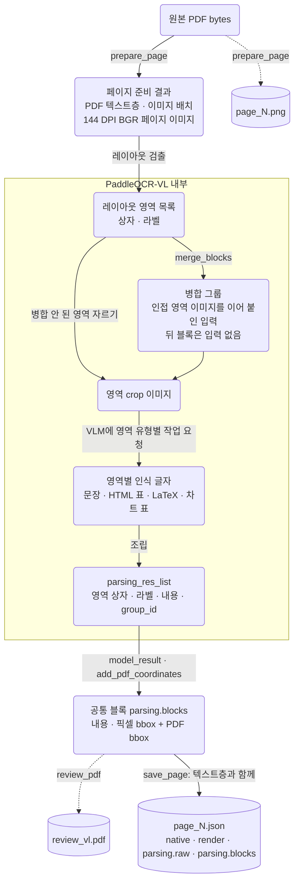

# 첫 파싱 실행 묶음: VL

- 실행 폴더: [parsing_vl_20261027T015138481163Z](../../../outputs/parsing_vl_20261027T015138481163Z)
- 검토: 최초 정성 검토 2026-10-30, 설치 패키지·저장 결과 추가 확인과 분류 정리 2026-11-02.
  최초 검토 기준 커밋 `3e54d62`, 추가 코드 확인 기준 `dcd6d29`.
- 같은 묶음의 Structure 기록: [2026-10-30_structure.md](2026-10-30_structure.md)
- 다음 묶음의 VL 기록: [2026-11-11_vl.md](2026-11-11_vl.md)
- 출처: `docs/parsing_log/PARSING_REVIEW.md`(커밋 `1655543`)를 모델별로 나눴다. 문장은 원문을 옮기고 위치만 바꿨다.
  두 파서에 공통인 절은 Structure 기록에도 같은 내용이 있다. 이후에 알게 된 내용은 본문에 섞지 않고 "후속:" 링크로만 달았다.

```text
PDF → 파싱 → 원본 대조·품질 검사〔현재〕 → 청킹 → 임베딩 → 인덱스 → 검색·평가
```

## 이슈 요약

이 기록에서 다룬 이슈다. 상태는 현재 기준이다. 다른 기록에서 해결했거나 원인을 찾은 이슈는 그 기록을 링크했다. 전체 목록은 [파싱 이슈 목록](README.md#이슈-목록)에 있다.

| ID | 모듈 | 이슈 유형 | 케이스 | 현재 상태 | 이 기록의 절 |
|---|---|---|---|---|---|
| P-01 | 레이아웃 병합 | 영역 병합으로 글자가 다른 블록에 귀속 | 게슈탈트 p8, 뉴스, NUS p22 | 해결([상세](2026-11-11_vl.md#3-레이아웃-영역-병합-해제)) | [3](#3-레이아웃-영역-병합-문장과-bbox의-귀속-불일치) |
| P-04 | 영역 인식 | 비정상 반복·원문에 없는 내용 | Toyota p2·p7 | 부분 해결([상세](2026-11-11_vl.md#4-vlm-영역-인식-생성-한도까지-반복된-출력)) | [4.1](#41-비정상-반복원문에-없는-내용) |
| P-06 | 영역 인식 | 단어 오인식·정보 누락 | 3M p9, NUS p9 | 관찰만 | [4.2](#42-관찰만-한-인식-문제) |
| P-07 | 영역 인식 | 그림 내부 문자 오인식 | RAG p3 | 관찰만 | [4.2](#42-관찰만-한-인식-문제) |
| P-15 | 차트 인식 | 원본과 맞지 않는 그래프 수치표 | 슬라이드 p15 | 관찰만 | [4.2](#42-관찰만-한-인식-문제) |
| P-10 | 표 인식 | 표 열·머리글 대응 손상 | DETR p13 Table 3, 3M p15 | 관찰만 | [5](#5-표-인식-열헤더-손상) |
| P-18 | 결과 저장 | 표 HTML의 그림 파일 누락 | UHD 설명서 p8 | 해결([상세](2026-11-11_vl.md#5-결과-변환저장-그림-crop-저장)) | [6](#6-결과-변환저장-model_resultpy-result_storepy) |
| P-19 | 결과 저장 | bbox 경계 0.11pt 초과로 partial | Toyota p21 | 관찰만 | [1.3](#13-구조무결성-검사-결과) |
| P-03 | 레이아웃·인식 | 도식 누락·영역 혼합 | Toyota p21 | 관찰만 | [8](#8-두-파서에서-공통으로-관찰된-인식-문제-vl-쪽-근거) |
| P-17 | 수식 인식 | 첨자 구조 손상 | DETR p5 식 (2) | 관찰만 | [8](#8-두-파서에서-공통으로-관찰된-인식-문제-vl-쪽-근거) |

## 1. 실행 개요

### 1.1 목적

파싱 출력이 원문의 내용·구조·위치를 보존하는지 확인한다.
파싱에 실패한 영역을 다음 청킹 단계에 그대로 넘기지 않도록 실패 유형과 근거를 정리한다.
2026-10-30 정성 검토는 저장된 결과와 원본의 대조였다.
2026-11-02에는 로컬 `.venv`에 패키지를 설치해 결과 객체 API와 일부 함수를 실행 확인했다.
모델 가중치를 사용하는 재추론, 파싱 코드 수정, 출력 교정, 검색 품질 측정은 수행하지 않았다.

이 검토 절차를 VL·Structure 뒤에 적용하는 설계는 [품질 검증 단계 구현 계획](../../planning/PARSING_VALIDATION_PLAN.md)에 정리했다.

### 1.2 범위와 조건

- [선정 목록](../../../configs/selection.json)의 9개 문서·27페이지를 비교했다.
- 페이지 번호는 PDF 첫 페이지를 1로 센 순번이며 인쇄된 쪽 번호와 구분한다.
- VL의 최초 실행은 3M 7·8·15페이지를 포함한다. 현재 비교는 8·9·15페이지이며,
  추가된 9페이지의 별도 실행 기록을 사용한다. 과거 7페이지는 비교에서 제외했다.
- VL 루트의 `run.json`·`summary.json`은 최초 실행 기록이다. 추가 실행을 포함하는 새 요약으로 해석하지 않는다.
- 실행 환경은 Windows·Python 3.12.14·PaddleOCR 3.7.0·PaddleX 3.7.2·PaddlePaddle 3.3.1 CPU·PyMuPDF 1.28.2·NumPy 2.3.5다.
  페이지 렌더링은 144 DPI다.
- 읽기 검사 환경은 macOS·기본 셸 zsh·Bash 명령·Python 3.12.10이다.
- `model_weight_revision`은 `null`이다. 모델 이름과 실제 가중치 revision 고정은 별개다.
- 특성별 목적 표본이다. 이 결과를 전체 MMDocIR의 오류율이나 파서의 일반적인 우열로 확대하지 않는다.

### 1.3 구조·무결성 검사 결과

| 검사 | 확인 결과 |
|---|---|
| 비교 입력 | Structure 실행과 27쌍의 원본 PDF 해시가 서로 같고 로컬 원본 PDF bytes의 SHA-256과 일치 |
| 페이지 이미지 | 27쌍의 기록된 PNG 해시·페이지 형상·native 추출 결과 일치. 각 PNG의 실제 해시도 기록과 일치 |
| 페이지 상태 | `ok` 26·`partial` 1 |
| 공통 블록 수 | 445개. 블록 수는 정확도 지표가 아님 |
| 요소 ID | 현재 비교 범위에서 중복 없음 |
| 좌표 계산 | 저장된 이미지→PDF 행렬로 재계산한 bbox가 저장된 PDF bbox와 일치 |
| 내용이 빈 블록 | text 23·image 1·vision_footnote 1 |
| 라이브러리 반환값→공통 블록 | 두 실행의 54개 페이지 JSON에서 내용과 이미지 bbox의 변경 없음 |
| 이미지 참조 | 설명서 표의 HTML에 이미지 경로 4개가 있으나 대응 파일이 문서 출력 폴더에 없음 |

빈 문자열은 누락 확정이 아니다. 병합 그룹의 후속 블록이거나 글자가 없는 이미지일 수 있다.
좌표 계산 일치도 그 좌표 안에 출력 문장이 실제로 존재한다는 뜻은 아니다.
Toyota 21페이지의 `partial`은 한 bbox가 PDF 오른쪽 경계를 약 0.11pt 넘은 경고다.
이미지 경계 안의 좌표가 PDF로 변환되면서 생긴 작은 초과이며 내용 오류의 크기를 나타내지 않는다.

### 1.4 평가를 수행한 방법과 한계

2026-10-30 검토에서는 저장된 27개 페이지 PNG를 `view_image`로 열어 이 대화의 이미지 이해 기능으로 읽었다.
Python으로 페이지 JSON의 `content`, `label`, bbox, 원본 텍스트층과 HTML 구조를 조회하고 두 파서를 비교했다.
로컬 원본 PDF 해시를 확인하고 일부 원본 텍스트는 pypdf로도 읽었다.
별도 OCR·VLM을 새로 실행하거나 학습된 자동 평가 모델의 점수를 받지는 않았다.
읽기 검사에 사용한 일회성 Python 코드는 저장소의 검증 프로그램으로 추가하지 않았다.

판정은 다음 근거를 함께 사용했다.

1. **원본과 출력의 직접 모순:** 원문은 두 열인데 한쪽 bbox에 양쪽 문장이 들어감, 원문 표의 열이 출력에서 빠짐.
2. **출력 자체의 이상:** 같은 단어의 긴 반복, 연속 번호 나열, 영어 그림에 무관한 문자가 나타남.
3. **위치와 내용의 대응:** 출력 문장이 그 bbox 안의 원문인지 확인. 페이지 전체에 글자가 존재하는 것만으로 통과시키지 않음.
4. **두 파서의 불일치:** 재검토 대상을 고르는 신호로 사용. 어느 파서도 정답으로 가정하지 않음.
5. **라이브러리·프로젝트 경계 추적:** 문제 내용이 `parsing.raw`에도 있는지 확인해 최초로 관찰되는 실패 구간을 좁힘.

이미지를 읽는 AI의 판단도 오류가 날 수 있다. 특히 작은 글자·회전 문자·복잡한 그래프의 정밀 수치는
시각 판단만으로 정답을 만들지 않는다. 별도의 정답 전사본·셀 매핑·좌표 라벨이 없어
CER/WER, 표 구조 정확도, 문장 위치 정확도, 전체 통과율은 측정하지 않았다.
검토 내용은 정성 평가와 일부 구조 검사이며 표준 벤치마크 결과가 아니다.
[OpenAI 공식 이미지 이해 문서](https://developers.openai.com/api/docs/guides/images-vision#limitations)도 작은 글자·회전·그래프·정밀 위치 판단의 한계를 설명한다.
이 일반 안내로 현재 대화 모델의 비공개 이미지 전처리·네트워크 구조를 추정하지 않는다.

### 1.5 데이터 흐름

이 실행 당시의 데이터 흐름이다. 노드는 데이터, 화살표는 그 데이터를 바꾸는 모듈·함수다. 원통은 파일로 저장되는 데이터다.
VL 내부 흐름은 원래 검토의 설명("레이아웃 영역을 자르고 필요시 합친 뒤, 영역 유형에 따라 OCR·표·수식·차트 작업을
VLM에 요청하고 결과를 조립한다")과 3.2절의 병합 경로로 그렸다.



native 텍스트가 있어도 모델에는 전체 페이지 이미지를 입력한다. native는 별도로 보존하는 대조 자료다.
`model_result.py`는 JSON 타입·좌표 형식·결과 개수를 검사한다. 문자열이 있으면 `ok`로 기록하지만
원문 사실성·표 의미·내용과 bbox의 대응은 검사하지 않는다.
`parsing.raw`는 라이브러리가 조립한 최종 JSON이며 VLM의 후처리 전 토큰·로짓·생성 기록은 아니다.
현재 공통 정리 단계는 원본 content와 bbox를 그대로 복사한다.

| 실행 기록으로 확인한 설정 | 공식 버전 설정의 구성 |
|---|---|
| PaddleOCRVL, pipeline_version v1.6, native backend, 레이아웃·차트·이미지 OCR 켜짐 | PaddleX 3.7.2 기본 YAML: PP-DocLayoutV3 + PaddleOCR-VL-1.6-0.9B |

VL은 레이아웃 영역을 자르고 필요시 합친 뒤, 영역 유형에 따라 OCR·표·수식·차트 작업을 VLM에 요청하고 결과를 조립한다.
라이브러리 안에 추가 처리가 있다. 이 처리와 이번 대화에서 수행한 결과 평가는 별개다.
모델의 학습 가중치 내부가 왜 특정 문장을 생성했는지까지 추적한 것은 아니다.
실제 다운로드된 모든 가중치의 파일 해시·revision·실행 중 설치 소스는 확보하지 못했다.

공식 자료는 설치 기록에 맞는 버전으로 확인했다.

- [PaddleX v3.7.2 VL 기본 설정](https://github.com/PaddlePaddle/PaddleX/blob/v3.7.2/paddlex/configs/pipelines/PaddleOCR-VL-1.6.yaml)
- [PaddleX v3.7.2 VL 실행 흐름](https://github.com/PaddlePaddle/PaddleX/blob/v3.7.2/paddlex/inference/pipelines/paddleocr_vl/pipeline.py)
- [PaddleX v3.7.2 영역 병합 구현](https://github.com/PaddlePaddle/PaddleX/blob/v3.7.2/paddlex/inference/pipelines/paddleocr_vl/uilts.py)
- [PaddleOCR v3.7.0 VL 래퍼와 병합 인자](https://github.com/PaddlePaddle/PaddleOCR/blob/v3.7.0/paddleocr/_pipelines/paddleocr_vl.py)

## 2. 입력·텍스트층 추출 (pdf_parser.py, 두 파서 공통)

이 절의 텍스트 파싱은 PyMuPDF의 `native` 경로다. 이미지 기반 모델의 `parsing` 결과와 구분한다.
현재 `pdf_parser.py`는 PDF의 블록·줄·span을 읽어 `native.raw`에 보존하고,
줄별 문자열을 연결해 `native.text`를 만든다.

| 문제 | 관찰과 근거 | 원인 확인 수준 | 후속 |
|---|---|---|---|
| 이미지 속 문자를 텍스트층에서 얻지 못함 | 선정 27페이지의 `native` 상태는 `ok` 20·`empty` 7·`failed` 0 | `empty`는 공백 이외 문자를 얻지 못한 상태다. 추출 예외나 페이지에 글자가 없다는 판정이 아님 | — |
| 수식의 공간 구조가 평문에서 풀림 | DETR 5페이지의 합 기호·위아래 첨자가 여러 줄 문자로 나타남. [페이지 JSON][detr5-vl]의 `native.text` | 문자열 연결만으로 수학적 구조를 보존하기 어려움. span 좌표는 별도 raw에 남음 | — |
| 읽기 순서를 보장하지 않음 | `get_text("dict", sort=False)`로 추출 목록과 좌표를 보존 | 다단 문서의 읽기 순서를 검증했다는 뜻이 아님. 모든 페이지의 순서가 틀렸다는 관찰도 아님 | — |
| 평문에 표의 논리 구조가 없음 | `native.text` 생성은 줄·span 문자열 연결이며 행·열·병합 헤더를 구성하지 않음 | 문자와 좌표가 남아 있어도 표의 논리 구조 복원은 별도 작업 | — |

텍스트층이 빈 페이지는 슬라이드 `0e94…`의 4·6·10·15페이지와 `competitiveoutcomes…`의 16·29·40페이지다.
과거 24페이지 실행에서 기록한 빈 페이지 6개와 구분한다.
선택·복사가 가능하다는 사전 관찰은 현재 추출의 완전성·순서·수식 정확성을 검증한 결과가 아니다.
두 모델에는 `native.text`가 아니라 페이지 전체 이미지가 들어간다.
따라서 native 추출의 손상을 VL·Structure 인식 오류의 직접 원인으로 연결하지 않는다.

## 3. 레이아웃 영역 병합: 문장과 bbox의 귀속 불일치

상태: 해결. 이 묶음에서는 원인 경로만 확인했고, [2026-11-11 VL 3절](2026-11-11_vl.md#3-레이아웃-영역-병합-해제)에서 병합을 끄고 해결했다.

### 3.1 어디서 보였나

- 게슈탈트 8페이지 왼쪽 블록 1에 Closure·Continuity가 함께 들어가고 오른쪽 블록 2는 비어 있음. 두 블록의 `group_id=1`.
  [게슈탈트 JSON][gestalt-vl] · [PNG][gestalt-img]
- 뉴스와 NUS 22페이지에도 영역 간 내용 병합 관찰.
- 구조 검사에서 내용이 빈 블록 25개(text 23·image 1·vision_footnote 1).

### 3.2 원인을 어떻게 찾았나

게슈탈트 VL raw에는 `merge_layout_blocks=True`와 두 텍스트 블록의 동일한 `group_id=1`이 있다.
PaddleX 3.7.2의 `merge_blocks()`는 조건에 맞는 영역의 이미지를 연결해 첫 블록의 입력으로 넣고,
나머지 그룹 블록의 이미지를 None으로 둔다. 개별 box는 그대로 남긴다.
조립 단계는 첫 블록에 인식 문자열을 넣고, 추론 입력이 없는 후속 블록에는 빈 문자열을 남길 수 있다.
이 동작은 관찰한 두 문장 병합·빈 블록·개별 bbox 유지와 일치한다.

2026-11-02 새로 설치한 PaddleOCR 3.7.0·PaddleX 3.7.2에서도 함수 동작을 확인했다.
게슈탈트 두 텍스트 bbox와 같은 크기의 모의 이미지를 `merge_blocks()`에 넣으면
첫 블록에 높이 299·너비 649의 합친 이미지가 들어가고 두 번째 블록 이미지는 `None`이 된다.
개별 bbox는 유지된다. 두 블록만 넣은 검사라 그룹 번호는 0이며, 원래 전체 페이지의 `group_id=1`과 구분한다.
이는 병합 분기의 재현이며 원본 픽셀을 사용한 모델 재추론이나 품질 개선 검증이 아니다.
실행 당시 설치 소스의 해시와 중간 crop은 없으므로 공개 버전 코드와 저장 결과에 근거한 발생 경로 판단이다.

### 3.3 해결책 (당시 제안, 미적용)

따라서 모든 빈 블록을 OCR 누락으로 세거나 PDF 좌표 변환을 고치는 접근은 적절하지 않다.
우선 라이브러리의 병합 그룹을 보존하고 같은 이미지에서 병합을 끈 결과와 비교해야 한다.

우선 두 문제를 구분한다.

- **좌표 계산 문제:** 원점·배율·회전·CropBox 변환 오류. 좌표 변환과 원문 overlay로 확인한다.
- **내용 귀속 문제:** 여러 영역의 텍스트가 한 블록에 들어감. 현재 VL의 대표 사례는 이 유형이다.

첫 비교 실험은 동일한 게슈탈트 8페이지에서 `merge_layout_blocks=True/False`만 바꾸는 것이다.
공식 v3.7.0 래퍼는 생성자와 predict에서 이 인자를 지원한다.
나머지 PDF·이미지·DPI·모델·디코딩 설정을 고정한다.

복구 표현은 다음 순서로 설계한다.

1. raw의 `group_id`와 소속 `model_block_id`를 파생 표현에 보존한다.
2. 그룹 전체 문자열에는 구성 bbox 목록을 연결한다. 큰 사각형 하나로 합치는 것은 정밀 문장 위치 복구가 아니다.
3. 문장별 위치가 필요하면 native span 또는 독립 OCR의 줄·단어 좌표와 문자열을 정렬한다.
4. OCR 줄 사각형 Q를 블록 B에 연결할 때 `area(Q ∩ B) / area(Q)`를 후보 점수로 사용할 수 있다.
   임계값·동점·여러 블록에 걸친 줄은 개발 표본에서 검증한다. bbox만으로 문장 의미 대응을 확정하지 않는다.
5. 대응을 찾은 문장만 해당 줄들의 좌표에 연결한다. 실패·중복 매칭은 미해결로 남기고 재인식 또는 검토한다.

문자열 유사도와 공간 겹침을 함께 확인하고 이미지 crop의 원점도 기록한다.
문장 원문 복구, 위치 정확성, 새 누락, 블록 수·지연 변화를 각각 비교한다.
페이지 전체 좌표나 그룹의 union bbox로 바꾼 것만으로 문장 위치를 검증했다고 표시하지 않는다.

### 3.4 결과

이 묶음에서는 미적용. 병합 비활성화가 품질을 개선했다는 실측 결론은 없었다.
후속: [2026-11-11 VL 3절](2026-11-11_vl.md#3-레이아웃-영역-병합-해제)

## 4. VLM 영역 인식

### 4.1 비정상 반복·원문에 없는 내용

상태: 부분 해결. 이 묶음에서는 최초 생성 원인을 확인하지 못했고, [2026-11-11 VL 4절](2026-11-11_vl.md#4-vlm-영역-인식-생성-한도까지-반복된-출력)에서 원인을 찾아 재인식으로 일부 해결했다.

**어디서 보였나.** Toyota 2페이지 블록 20에 무관한 국제학회 문장과 `China` 2,029회 반복. 페이지 상태는 `ok`.
7페이지 도식에서도 반복 관찰. [2페이지 JSON][toyota2-vl] · [PNG][toyota2-img]

**원인을 어떻게 찾았나.** 반복이 필터에 남는 경로는 추가 확인했고, 최초 생성 원인은 확인하지 못했다.
2026-11-02 설치된 PaddleX 3.7.2의 `truncate_repetitive_content()`에 Toyota 2페이지의
저장 문자열 14,355자를 다시 넣었을 때 문자열이 그대로 반환됐다. 줄바꿈 2개가 있어
단일 행의 구절·문자 반복 검사에서 제외되고, 비어 있지 않은 줄 수가 기본 임계값 10보다 적어
줄 반복 검사에서도 제외된다. 이 확인은 이미 저장된 문자열을 함수에 재입력한 결과이며,
실제 추론 당시의 후처리 전 출력이나 최초 반복 생성 원인을 확보한 것은 아니다.

**해결책(당시 제안, 미적용).**

1. 블록별로 정규화한 단어·문자 n-gram의 반복 비율, 최장 연속 반복, 같은 줄의 중복을 센다.
2. 긴 연속 번호·빈 수치 행, 영역 크기에 비해 비정상적으로 긴 출력도 별도 신호로 남긴다.
3. 숫자·고유명사·언어가 native 텍스트 또는 독립 OCR과 크게 다르면 원본 대조 대상으로 표시한다.
4. 신호가 있어도 바로 지우지 않는다. 문서의 정상적인 반복 헤더·표 값과 구분해 원본 영역을 확인한다.
5. 확인된 손상 출력은 검색 표현에서 보류하고 원본 이미지·문서 연결을 남긴다. 단순 반복 제거로 나머지 문장까지 정확해지지는 않는다.

반복 규칙은 이상 탐지다. 반복이 없는 환각을 놓칠 수 있고 다른 OCR도 같은 오류를 낼 수 있다.
OCR confidence 역시 문장의 사실성 확률이 아니다. 명확한 원문 대조 없이 환각 확정 라벨을 붙이지 않는다.
재인식한다면 같은 영역의 해상도·모델·디코딩 설정 중 하나만 바꾸고 원문 복구량·잘림·비용을 비교한다.
길이 제한만 줄이면 정상적인 큰 표도 잘릴 수 있으므로 해결책으로 단정하지 않는다.

**결과.** 이 묶음에서는 미적용. 첫 규칙 검사(아래 7절)로 반복 신호를 표시하는 것까지 구현했다.

### 4.2 관찰만 한 인식 문제

| 문제 | 관찰과 근거 | 원인 확인 수준 | 후속 |
|---|---|---|---|
| 단어 오인식·정보 누락 | 3M 9페이지 `Elected`를 `Executed`로 인식. NUS 9페이지 전공 조합 일부 누락 | 결과에서 확인. 세부 발생 단계는 미확인 | — |
| 그림 내부 문자 오인식 | RAG 3페이지의 `dismissal`을 `原始`로 출력. [JSON][rag3-vl] · [PNG][rag3-img] | 출력과 원문 불일치 관찰. 작은 문자 인식과 생성 과정의 기여는 분리하지 못함 | — |
| 근거가 맞지 않는 그래프 수치표 | 슬라이드 15페이지의 생성 수치표가 원본 막대 변동과 맞지 않음 | 정성 관찰. 정밀 수치 정답과 전체 오류율은 미측정 | — |

## 5. 표 인식: 열·헤더 손상

| 문제 | 관찰과 근거 | 원인 확인 수준 | 후속 |
|---|---|---|---|
| 표의 열·헤더 손상 | DETR 13페이지 Table 3의 헤더 대응과 마지막 Δ열 손실. 3M 15페이지에도 여분 빈 열·헤더 문제. [DETR JSON][detr13-vl] · [PNG][detr13-img] | 표 인식 결과의 손상 확인. 검출·입력 crop·생성 중 최초 원인은 미확인 | — |

표 검증 방법(당시 제안, 두 파서 공통):

1. 표 HTML을 파싱해 rowspan·colspan을 반영한 논리 격자로 펼친다. 태그 구문 오류·셀 겹침·예상하지 않은 빈칸을 기록한다.
2. 각 값에 행 키와 다단 헤더 경로를 연결한다. 예: `Same period last year × Three months ended / December 31, 2018 → 0.85`.
3. 원본의 셀 위치·OCR 문자열과 연결해 숫자가 다른 행·열로 이동했는지 검사한다.
4. 음수 괄호·소수점·퍼센트·통화·단위·대시·빈칸·체크·이미지 셀을 각각 검증한다. 빈칸과 대시를 0으로 통일하지 않는다.
5. 반복 헤더와 이어지는 표는 문서·페이지·원본 헤더를 유지한 채 연결한다. 원본 행과 재구성 행을 구분한다.
6. 합계가 명시된 경우 보조 검산을 한다. 반올림·소계·중복 집계 규칙이 없으면 합계만으로 셀 배치를 확정하지 않는다.

직사각형 격자와 HTML 구문이 정상이어도 의미상 틀린 표일 수 있다.
원본으로 확인한 작은 셀 대응 정답을 만든 뒤 셀 내용 정확도와 행·열·헤더 대응 정확도를 따로 측정한다.
복구되지 않은 표는 이미지와 캡션을 보존하고 구조화 수치 검색에 넣을지는 보류한다.

## 6. 결과 변환·저장 (model_result.py, result_store.py)

| 문제 | 관찰과 근거 | 원인 확인 수준 | 후속 |
|---|---|---|---|
| 라이브러리 JSON → 공통 블록 변환 | 두 실행 54페이지·829개 블록에서 content·이미지 bbox의 변경 0개 | 위 인식 손상은 공통 블록 변환 이전 결과에 이미 존재 | — |
| 이미지 파일 참조의 불완전성 | UHD 설명서 표 HTML의 이미지 경로 4개에 대응 파일이 없음 | 결과 이미지 저장 누락. OCR 문자 정확도와 별개. 2026-11-08부터 `markdown_images`를 페이지별 `imgs/`에 저장하도록 수정했으나 재실행 전이라 기존 결과는 그대로다 | [2026-11-11 VL 5절](2026-11-11_vl.md#5-결과-변환저장-그림-crop-저장) |
| 결과 객체의 시각화·crop 미보존 | 2026-11-08 이전 `model_result.py`는 `first.json`만 읽었다. 이후 `markdown_images`는 저장하지만 `img` 시각화와 병합된 VLM 입력 crop은 여전히 저장하지 않음 | 전체 페이지 PNG는 별도 보존하지만 결과 객체의 이미지와 구분해야 함 | — |
| 관계 표현 부족 | 공통 블록에 캡션↔그림·수식↔번호·페이지 간 표의 명시적 연결 없음 | 프로젝트 표현 설계의 한계. 라이브러리의 모든 결과에도 관계가 없다고 단정하지 않음 | — |
| 상태와 품질의 혼동 가능성 | 문자열이 있으면 파싱 `ok`. 원문 사실성·문장 위치·셀 의미 대응은 검사하지 않음 | 처리 성공과 품질 판정을 분리해야 함 | — |

Toyota 21페이지의 약 0.11pt 경계 초과는 좌표 경고다.
문장 전체가 다른 bbox에 붙는 내용 귀속 문제와 같은 원인·심각도로 묶지 않는다.

설치된 결과 객체에서 이미지를 읽는 API(macOS·Python 3.12.10 `.venv`, PaddleOCR 3.7.0·PaddleX 3.7.2,
샘플 데이터로 확인, 모델 로딩·새 추론 없음):

| 목적 | 접근 API | 반환값·조건 |
|---|---|---|
| 레이아웃 검출 시각화 | `res.img["layout_det_res"]` | 해당 결과가 제공될 때 PIL 이미지 |
| 문서 그림 crop 묶음 | `res.markdown["markdown_images"]` | 상대 경로 → PIL 이미지 딕셔너리 |
| 개별 블록 이미지 | `res["parsing_res_list"][i].image["img"]` | `.image`가 `None`이 아닌 블록. 경로는 `.image["path"]` |
| 시각화 파일 저장 | `res.save_to_img(save_path=...)` | 파일 생성. 여러 시각화가 있으므로 폴더 경로 사용 |
| Markdown·그림 저장 | `res.save_to_markdown(save_path=...)` | Markdown과 참조 이미지 파일 생성 |

`img`·`markdown`·`json`은 메서드가 아닌 속성이다. 기본 `res.json`은 블록 이미지 객체를 보존하지 않는다.
그림 crop 묶음과 검출 시각화는 서로 다르며, 병합된 VLM 입력 crop 전부를 반환하는 API도 아니다.
최종 결과에 남지 않는 중간 이미지는 처리 단계에서 별도로 확보해야 한다.
위 API는 라이브러리 기능 확인이며 프로젝트에 저장 기능을 추가했다는 뜻이 아니다.
근거: [VL 결과 클래스](https://github.com/PaddlePaddle/PaddleX/blob/v3.7.2/paddlex/inference/pipelines/paddleocr_vl/result.py),
[이미지·Markdown 속성과 저장 메서드](https://github.com/PaddlePaddle/PaddleX/blob/v3.7.2/paddlex/inference/common/result/mixin.py).

## 7. 후처리: 규칙 검사

2026-11-02 현재 선정 목록으로 규칙 검사(0.1.0)를 실행한 결과 VL 검토 대상은 13/27페이지다.
신호는 병합 그룹 22·긴 번호 나열 2·단어 집중 반복 1·3단어 묶음 반복 1·출력 길이 1이다.
같은 페이지에 여러 신호가 생길 수 있고, 검토 신호 수는 정확도나 파서 우열이 아니다.
기존 테스트 20개와 설치 패키지 의존성 검사를 통과했다. 모델 품질 테스트를 통과했다는 뜻은 아니다.

## 8. 두 파서에서 공통으로 관찰된 인식 문제 (VL 쪽 근거)

| 공통 문제 | VL 쪽 근거 | 확인 범위와 한계 |
|---|---|---|
| 수식의 의미 구조 손상 | DETR 5페이지 식 (2)의 `\hat{b}_{\hat{\sigma}(i)}`를 두 파서 모두 `\hat{b}_{\hat{\sigma}}(i)` 형태로 출력. [VL][detr5-vl] · [PNG][detr5-img] | LaTeX 존재와 첨자 의미 보존은 다름. 두 파서의 내부 원인이 같다는 뜻은 아님 |
| 복잡한 표의 구조 손상 | DETR 13페이지에서 VL은 Table 3에 손상. [VL][detr13-vl] | 같은 표에서 똑같이 실패했다는 분류가 아니라, 두 경로 모두 표 구조 오류가 있다는 뜻 |
| 도식 누락·영역 혼합 | Toyota 21페이지에서 양쪽 파서에 관찰 | 문자 인식뿐 아니라 영역 구분·내용 배정도 검토 필요 |
| 그림 내부 정보의 불완전한 복원 | RAG 3페이지에서 VL은 단어 오인식. [VL][rag3-vl] · [PNG][rag3-img] | 같은 입력에서도 실패 방식이 다름. 어느 한 출력을 정답으로 사용할 수 없음 |

작은 글자·회전 문자·장식 글꼴·축·범례·화살표·조직도 관계는 추가 검토 대상이다.
캡션 평가는 원문에 인쇄된 캡션의 추출이며, 그림의 새 설명문 생성 품질을 평가한 것이 아니다.

## 9. 문서별 관찰

"파서 구분 없음"은 원래 검토에서 어느 파서의 결과인지 나누지 않고 적은 관찰이다.

| 문서·PDF 페이지 | VL에서 확인한 내용 | 파서 구분 없음 |
|---|---|---|
| 뉴스 `0b854…` 1·3·11 | 단을 넘는 문장을 한 블록에 합치고 다른 블록을 비움 | 제목·본문·사진 설명은 상당 부분 읽힘. 생물학 도식의 글자는 일부 복구하지만 화살표 관계는 구조화하지 않음 |
| 슬라이드 `0e94…` 4·6·8·10·15 | 8페이지 문장–bbox 불일치. 15페이지 수치표는 원본 막대 변동과 맞지 않아 신뢰 불가 | 4페이지 작은 연도·임무명 오인식, 6페이지 우주개발 도표의 비정상 수치표, 10페이지 지도 범례는 일부 복구 |
| 3M 8·9·15 | 9페이지 Elected→Executed 오인식. 15페이지는 수치·행 대응을 Structure보다 잘 유지하나 여분 빈 열과 헤더 문제 존재 | 8·9페이지 인명·직책 표는 상당 부분 읽힘 |
| DETR `2005.12872v3` 5·13 | 13페이지 Table 4는 Structure보다 잘 보존, Table 3은 헤더 대응·마지막 열 손실 | 5페이지 수식 첨자 결합 오류. 그림 내부 zebra 라벨 복구는 불완전 |
| RAG `2312.10997v5` 3·4·6 | 3페이지 그림 속 단어 오인식 | 3·4페이지 캡션은 대체로 추출. 그림 내부의 단어·읽기 순서·반복 오류 존재 |
| competitiveoutcomes 16·29·40 | — | 이미지뿐인 페이지에서도 OCR 결과가 생김. 16페이지 그래프 수치 복원은 신뢰 불가. 29페이지 주요 라벨·캡션은 일부 복구하나 축·곡선 관계는 보존하지 못함. 40페이지 잡지 표지의 장식 글자·숫자 오류 |
| UHD 설명서 8 | 이미지 파일 참조가 연결되지 않음 | 본문과 표의 상태·응답 문구는 상당 부분 읽힘. 아이콘과 동작의 연결 불완전 |
| Toyota 2·7·21·32·34 | 2페이지 미리보기와 7페이지 원뿔 도식에서 비정상 반복. 21페이지 도식 누락·영역 혼합(양쪽 파서) | 32페이지 조직도·연표 관계 손상, 34페이지 일부 표의 병합셀과 각주 확인 필요 |
| NUS 9·22 | 9페이지 전공 조합 일부 누락. 22페이지 상단 두 단을 한 bbox에 합침 | 사진 설명은 일부 추출되지만 연결 라벨·순서 불안정 |

이 표는 페이지별 모든 문자·셀을 전수 채점했다는 뜻이 아니다. 확인한 대표 실패와 성공을 요약한다.

## 10. 해석과 한계, 다음 단계

### 10.1 2026-11-02 확인 당시의 변경 기록과 효과 측정

| 항목 | 구현 상태 | 한계 |
|---|---|---|
| 실행 조건·입력 추적 | `run.py`의 환경·패키지 버전·선정 목록·코드 해시, 페이지의 PDF·PNG 해시·ID·좌표 | 실행 조건을 남기지만 Git commit·diff와 변경 이유를 자동 기록하지 않음 |
| 명시적 predict 설정 기록 | `dcd6d29`부터 두 어댑터의 `predict_options()`를 실제 호출과 `run.json` 기록에 함께 사용 | 생략한 라이브러리 기본값 전체나 모든 디코딩 적용값을 기록하는 것은 아님 |
| 시간·오류 기록 | 페이지 추론 시간, 실행·모델 로딩 시간, 실패 단계·오류 | 메모리·모델 가중치 revision·가중치 해시는 미확보 |
| 규칙 검사 | 입력 해시·ID·좌표·반복·병합 그룹·HTML 격자 검사와 별도 보고서 | 원문 의미 정확도는 미측정. `quality_accuracy`는 `null` |
| 실행 간 변경 비교 | 미구현 | 설정·소스·입력의 전후 차이를 연결하는 자동 보고서가 없음 |
| 수정 효과의 품질 비교 | 미구현 | 복구한 문장·새 누락·문장 위치·표 셀 대응의 전후 점수가 없음 |

이후 구현 방향은 [단계별 실행 기록과 전후 비교 계획](../../planning/EXPERIMENT_COMPARISON_PLAN.md),
2026-11-05에 추가한 기록·비교 코드의 사용법은 [실행 비교 사용법](../../planning/EXPERIMENT_COMPARISON_USAGE.md)에 있다.
과거 결과에 새 메모리·revision·품질 점수를 채워 넣지 않았다.

### 10.2 다음 실행의 입력과 출력 (당시 제안)

| 구분 | 필요한 정보 |
|---|---|
| 입력 | source_sha256, page_id, PNG 해시·DPI, 원본 raw·blocks, 실행 설정·모델 revision |
| 평가 기록 제안 | element_id, 검사 규칙·버전, 관찰값·임계값, 원본 근거, 의심/확인/미해결 판정 |
| 복구 결과 제안 | 원본 element_id 목록, 파생 content·위치 목록, 복구 방법·버전, 실패 이유 |
| 비교 | 복구한 정보뿐 아니라 새 누락·잘못 바꾼 내용·위치 오류·지연·메모리도 기록 |
| 청킹에 전달 | 원문과 연결된 검증 상태·사용할 표현·해결되지 않은 제한 |

위 필드는 제안 스키마다. 현재 JSON에 이미 존재하거나 구현됐다는 뜻이 아니다.
이 검토로 기존 run.json의 `quality_evaluation: not_run`을 변경하지 않았다.
규칙의 초기 임계값은 개발용 표본에서 정하고, 최종 평가 표본에 맞춰 반복 조정하지 않는다.

## 대표 증거

| 사례 | 원본 대조와 JSON 관찰 | 근거 |
|---|---|---|
| Toyota 2페이지 반복 | 블록 20에서 무관한 국제학회 문장과 `China` 2,029회 반복. 페이지 상태는 `ok` | [VL JSON][toyota2-vl] · [PNG][toyota2-img] |
| 게슈탈트 8페이지 위치 불일치 | 블록 1의 bbox는 왼쪽인데 Closure·Continuity가 함께 들어감. 오른쪽 블록 2는 빈 문자열이며 두 블록의 raw group_id는 1 | [VL JSON][gestalt-vl] · [PNG][gestalt-img] |
| DETR 13페이지 Table 3 | 헤더 대응과 마지막 Δ열을 잃음 | [VL JSON][detr13-vl] · [PNG][detr13-img] |
| DETR 13페이지 Table 4 | 표 대응을 Structure보다 잘 유지 | 위 DETR 13페이지 근거와 동일 |
| 3M 15페이지 수치 | 원문 Same period last year의 0.85 대응을 유지 | [VL JSON][3m15-vl] · [PNG][3m15-img] |
| DETR 5페이지 식 (2) | 원문의 `\hat{b}_{\hat{\sigma}(i)}`를 `\hat{b}_{\hat{\sigma}}(i)` 형태로 출력 | [VL JSON][detr5-vl] · [PNG][detr5-img] |
| RAG 3페이지 그림 내부 | 원문 dismissal을 原始로 출력. 캡션 추출은 상대적으로 양호 | [VL JSON][rag3-vl] · [PNG][rag3-img] |
| RAG 6페이지 표 하단 | HTML tr 수 72(Structure 62) | [VL JSON][rag6-vl] · [PNG][rag6-img] |

[toyota2-vl]: ../../../outputs/parsing_vl_20261027T015138481163Z/documents/2eaa8902b6ea6415e13186080fa7b9f310e6c49a358438097677c2f91deb4298/page_00002.json
[toyota2-img]: ../../../outputs/parsing_vl_20261027T015138481163Z/documents/2eaa8902b6ea6415e13186080fa7b9f310e6c49a358438097677c2f91deb4298/page_00002.png
[gestalt-vl]: ../../../outputs/parsing_vl_20261027T015138481163Z/documents/670aceefba12d5fde77212a555eb25fd3dc06a489a21bbe2b559421a2a363f82/page_00008.json
[gestalt-img]: ../../../outputs/parsing_vl_20261027T015138481163Z/documents/670aceefba12d5fde77212a555eb25fd3dc06a489a21bbe2b559421a2a363f82/page_00008.png
[detr13-vl]: ../../../outputs/parsing_vl_20261027T015138481163Z/documents/86582f690906603c36f8bc08266640f92e879b79b7bcdaaadb16bcc23823f87f/page_00013.json
[detr13-img]: ../../../outputs/parsing_vl_20261027T015138481163Z/documents/86582f690906603c36f8bc08266640f92e879b79b7bcdaaadb16bcc23823f87f/page_00013.png
[3m15-vl]: ../../../outputs/parsing_vl_20261027T015138481163Z/documents/772c0ad228f8f35bd4492ae6e5a5d7022a6db46553f91a0cf021037b5c5d1d36/page_00015.json
[3m15-img]: ../../../outputs/parsing_vl_20261027T015138481163Z/documents/772c0ad228f8f35bd4492ae6e5a5d7022a6db46553f91a0cf021037b5c5d1d36/page_00015.png
[detr5-vl]: ../../../outputs/parsing_vl_20261027T015138481163Z/documents/86582f690906603c36f8bc08266640f92e879b79b7bcdaaadb16bcc23823f87f/page_00005.json
[detr5-img]: ../../../outputs/parsing_vl_20261027T015138481163Z/documents/86582f690906603c36f8bc08266640f92e879b79b7bcdaaadb16bcc23823f87f/page_00005.png
[rag3-vl]: ../../../outputs/parsing_vl_20261027T015138481163Z/documents/de7c2798d40a0c5c32b38e3ba65c0e70f93ab1ddad234a554ed74afa49ccf9b1/page_00003.json
[rag3-img]: ../../../outputs/parsing_vl_20261027T015138481163Z/documents/de7c2798d40a0c5c32b38e3ba65c0e70f93ab1ddad234a554ed74afa49ccf9b1/page_00003.png
[rag6-vl]: ../../../outputs/parsing_vl_20261027T015138481163Z/documents/de7c2798d40a0c5c32b38e3ba65c0e70f93ab1ddad234a554ed74afa49ccf9b1/page_00006.json
[rag6-img]: ../../../outputs/parsing_vl_20261027T015138481163Z/documents/de7c2798d40a0c5c32b38e3ba65c0e70f93ab1ddad234a554ed74afa49ccf9b1/page_00006.png
