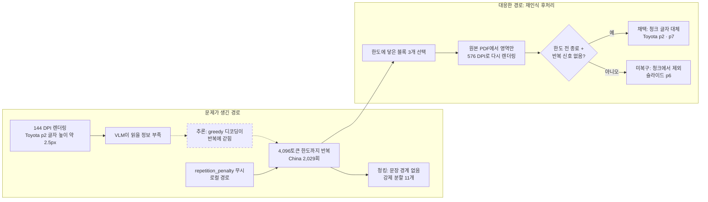

# 병합 해제 재파싱 묶음: VL

- 실행 폴더: [parsing_vl_20261110T233124280038Z](../../../outputs/parsing_vl_20261110T233124280038Z)(재파싱),
  [rerecognition_vl_20261111T101144801007Z](../../../outputs/rerecognition_vl_20261111T101144801007Z)(생성 한도 블록 재인식)
- 코드: 병합 해제·그림 저장 `66bc54a`(#13), 재파싱 실행 코드 `dcd68e6`, 원인 조사 `8ec2789`(#18), 재인식·규칙 0.3.0 `1655543`(#19)
- 같은 묶음의 Structure 기록: [2026-11-11_structure.md](2026-11-11_structure.md)
- 이전 묶음의 VL 기록: [2026-10-30_vl.md](2026-10-30_vl.md)
- 출처: `docs/parsing_log/REPARSE_RESULT.md`의 VL 부분과 `docs/parsing_log/PARSING_ROOT_CAUSES.md`의 1·2·7·8·9.1절(커밋 `1655543`)을
  옮겨 모듈 순서로 다시 배치했다. "이번 정리에서 덧붙인 해석"이라고 표시한 부분만 2026-11-12에 새로 썼다.
  실행 환경 문제(중단, 시스템 패키지, CRLF)는 [환경 기록](../../environment/log/README.md)에 있다.

```text
PDF → 파싱〔재실행·전후 비교·원인 조사〕 → 재인식 → 청킹 → 임베딩 → 인덱스 → 검색·평가
```

## 1. 실행 개요

### 1.1 목적

[이전 묶음](2026-10-30_vl.md#3-레이아웃-영역-병합-문장과-bbox의-귀속-불일치)에서 문장–bbox 불일치의 유력한 원인은 PaddleX의
영역 병합(`merge_layout_blocks=True`)이었다. PR #13에서 다음 두 가지를 바꿨다.

- `merge_layout_blocks=False`로 병합을 끈다.
- 결과 객체의 그림 crop(`markdown_images`, 표 안 그림 포함)을 저장한다.

같은 27페이지를 다시 파싱해, 병합 해제가 빈 블록과 몰린 텍스트를 없애는지와 다른 결과가 바뀌는지 확인했다.
이후 재파싱 뒤에도 남은 문제의 원인을 조사하고(2026-11-11), 사실로 확인한 원인에 맞춰 재인식을 적용했다.

### 1.2 조건

| 항목 | 새 실행 | 기준 실행 |
|---|---|---|
| 실행 폴더 | [parsing_vl_20261110T233124280038Z](../../../outputs/parsing_vl_20261110T233124280038Z) | [parsing_vl_20261027T015138481163Z](../../../outputs/parsing_vl_20261027T015138481163Z) |
| 바뀐 설정 | `parser_options.merge_layout_blocks`: `False` | 키 없음(기본 병합) |
| 페이지 상태 | `ok` 26·`partial` 1 | 같음 |
| 실행 환경 | Coder 컨테이너, Linux, Python 3.12.16, CPU 4스레드, 144 DPI | Windows PC, Python 3.12.14, CPU 4스레드, 144 DPI |

- 원본 PDF 9개는 기준 실행과 해시가 같다(`different_pdf_pages: 0`).
- 패키지(PaddleOCR 3.7.0·PaddleX 3.7.2·PaddlePaddle 3.3.1)는 기준 실행과 같다. 플랫폼과 Python 빌드는 다르다.
- 시작 47분 뒤 외부 종료 신호로 끊겨 `main.py --resume`으로 같은 폴더에서 재개했다. 저장된 4페이지는 다시 추론하지 않았다
  ([컨테이너 종료](../../environment/log/2026-11-11_container-termination.md)).
- 기준 VL 실행의 3M 9페이지는 최초 실행이 아니라 추가 실행 기록(`page_00009_run.json`)이다.
  비교는 현재 [선정 목록](../../../configs/selection.json)의 27페이지(3M 8·9·15)를 기준으로 했다.

### 1.3 비교 방법

| 비교 | 도구 | 결과 위치 |
|---|---|---|
| 실행 전후 보고서 | `experiments.compare` | [comparison.md](../../../outputs/parsing_vl_20261110T233124280038Z_comparison/comparison.md) |
| 규칙 검사 | `parsing.validate_run` 규칙 0.2.0, 원본 PDF 대조 | 보고서는 저장소에 넣지 않음. 아래 명령으로 다시 만들 수 있음 |
| 블록 단위 대조 | 일회성 분석 스크립트(저장소 밖) | 페이지별 블록 내용·bbox·라벨 일치 여부, 빈 블록, 텍스트층 토큰 겹침 |

- 보고서는 손으로 실행했다. 재개 때 처음 지정한 비교 기준이 이어지지 않아 자동 비교가 생략됐기 때문이다. PR #16에서 고쳤다.
- 텍스트층 토큰 겹침은 PDF 텍스트층(PyMuPDF)의 단어가 파싱 결과에 몇 % 있는지 보는 대리 지표다. 정답 기반 정확도가 아니다.
- 보고서의 `before_problems: 9`는 품질 문제가 아니다. 기준 실행 폴더에 원본 PDF 사본이 없어 기록된 해시만 확인한 9개 문서를 센 것이다.

```bash
.venv/bin/python -B -m parsing.validate_run --run-dir "$RUN_DIR" \
  --selection "$RUN_DIR/selection.json" --pdf-dir "$PDF_DIRECTORY" --output "$REPORT_JSON"
```

### 1.4 결과 요약

| 지표 (27페이지) | 기준 | 새 실행 |
|---|---|---|
| 블록 수 | 445 | 445 |
| bbox·라벨이 기준과 같은 페이지 | — | 27 |
| 블록 내용이 기준과 같은 페이지 | — | 16 |
| 병합 그룹(블록 2개 이상이 같은 `group_id`) | 22 | 0 |
| 내용이 빈 블록 | 25 (text 23·image 1·vision_footnote 1) | 2 (image 1·vision_footnote 1) |
| 전체 글자 수 | 121,625 | 121,604 |
| 저장한 그림 crop | 기록 없음 | 52 |
| 규칙 검사에서 검토가 필요한 페이지 | 14 | 3 |

### 1.5 시간·메모리

| 항목 | 기준 | 새 실행 |
|---|---|---|
| 실행 시간 | 49,091초 | 2,831초(중단 전) + 12,980초(재개) |
| 페이지 처리 시간 합 | 50,061초 | 15,677초 |
| 최대 RSS | 기록 없음 | 9.92GB(중단 전) · 9.88GB(재개) |

- 새 실행이 빠르지만 기기가 다르다(Windows PC 대 72코어 컨테이너, 스레드는 둘 다 4). 코드 변경의 효과로 볼 수 없다.
  비교 보고서도 재개 실행이라 시간을 `not_comparable_resumed`로 표시한다.
- 기준 실행은 메모리 기록 기능을 넣기 전이라 최대 RSS가 없다. GB는 10^9바이트 기준이다.
- 재개 구간의 메모리 원시 로그 `resume/segment_2/resources.jsonl`(88MB)은 저장소에 넣지 않았다.
  SHA-256은 `d5be00348cd5d8af06ba562bde0ce920369f24a584c04bc168f649ca7f6e59c0`이고, 최대 RSS 집계는 실행 폴더의 `experiment_finished.json`에 있다.

## 2. 입력·렌더링: VLM이 빨강·파랑이 바뀐 이미지를 받음

상태: 미해결. 원인 경로는 확인했고 전체 품질 영향은 측정하지 않았다.

**1. 어디서 보였나.** 4절의 원인을 찾으려고 Toyota p2 블록을 해상도만 바꿔 인식하는 통제 실험을 했다.
첫 실험에서 RGB 배열을 넣었더니 144 DPI 출력이 파이프라인 출력과 달랐다.

**2. 원인을 어떻게 찾았나 (사실).**
- 프로젝트는 PaddleOCR 관례대로 BGR 페이지 배열을 넘긴다(`parsing/pdf_parser.py`).
- PaddleX VL 파이프라인은 이 배열에서 블록을 잘라 색 변환 없이 VLM에 넘긴다.
- 로컬 처리기 `fetch_image()`는 배열을 `Image.fromarray()`로 그대로 읽는다.
- 그래서 파이프라인에서 VLM은 빨강·파랑 채널이 바뀐 이미지를 받는다.
- BGR로 다시 실험하자 출력이 파이프라인과 같아졌다(4절 2.5의 재현 확인).

576 DPI 조건에서 RGB 입력의 텍스트층 재현율(0.89)이 BGR 입력(0.79)보다 높았다. 블록 하나의 결과이므로
채널 순서가 전체 인식 품질에 주는 영향은 판단하지 않는다.

**3. 왜 이 해결책을 골랐나.** 미적용. 당시 후보는 VLM 입력을 RGB로 바꾸는 조건과 현재 조건을 같은 27페이지에서
비교하는 것이다. PaddleX 내부 동작을 바꾸는 일이라 영향 범위를 먼저 확인해야 한다.
4절의 재인식은 파이프라인과 조건을 맞추려고 BGR 입력을 그대로 썼다.

**4. 결과.** 미적용.

**5. 남은 문제.** VLM이 채널이 바뀐 입력을 받는 것이 의도된 동작인지 확인하지 않았다(PaddleX 문서·학습 조건 미확인).

## 3. 레이아웃 영역 병합 해제

상태: 해결. 병합 그룹과 빈 text 블록이 사라졌다. 블록별 글자가 원문 위치와 맞는지는 예시 몇 개만 확인했다.

**1. 어디서 보였나.** [이전 묶음 3절](2026-10-30_vl.md#3-레이아웃-영역-병합-문장과-bbox의-귀속-불일치): 게슈탈트 8페이지
왼쪽 블록에 두 문단이 들어가고 오른쪽 블록이 비었다. 빈 text 블록 23개, 규칙 검사 병합 그룹 신호 22건.
첫 청킹에서도 VL 빈 내용 제외 24개, 병합 그룹 신호 청크 17개로 드러났다
([첫 청킹](../../chunking/log/2026-11-10_first-structural-chunking.md)).

**2. 원인을 어떻게 찾았나.** 이전 묶음 3.2절. PaddleX `merge_blocks()`가 인접 영역 이미지를 이어 붙여 첫 블록에서
한 번에 인식하고, 뒤 블록은 빈 내용으로 둔 채 bbox만 남긴다. 2026-11-02 모의 입력으로 함수 동작을 재현했다.

**3. 왜 이 해결책을 골랐나.**
- 당시 제안(이전 묶음 3.3절): 같은 페이지에서 `True/False`만 바꿔 비교한다. 복구 표현으로 그룹 보존과 문장–좌표 정렬을 설계했다.
- 당시 선택(2026-11-08, `parsing/vl_parser.py` 주석): VL 어댑터 생성자 설정에 `merge_layout_blocks=False`를 명시했다.
  청킹·검색은 bbox로 원문 위치를 찾으므로 영역마다 따로 인식하도록 끈다고 적었다. 대가로 상자 경계에서 문장이 나뉘고
  VLM 호출 수가 늘 수 있다고 적었다. `True` 실행은 기록 설정의 `pipeline_options`로 이 값만 덮어써 비교할 수 있게 했다.
- 이번 정리에서 덧붙인 해석(2026-11-12): 병합 끄기는 글자가 몰리는 원인 자체를 없앤다. 그룹 보존과 문장 정렬은 이미 몰린
  글자를 다시 나누는 복구라 정렬 규칙·임계값을 새로 정해야 한다. 원래 계획한 "같은 환경에서 True/False만 바꾼 대조"는 하지 않았고,
  실제 비교는 다른 기기의 기준 실행과 했다.

**4. 결과 (1.4절 표).**
- 병합 그룹 22→0, 빈 text 블록 23→0. bbox·라벨·블록 수는 그대로다.
- 내용이 바뀐 11페이지는 모두 기준 실행에 병합 그룹이 있던 페이지다. 텍스트만 블록 사이에서 다시 나뉘었다.
  예: 뉴스 1페이지 블록 19는 기준에서 288자(두 단락이 이어짐)였고 블록 20은 비어 있었다. 새 실행에서는 블록 19가 65자, 블록 20이 222자다.
  게슈탈트 슬라이드 8페이지의 Closure(블록 1)·Continuity(블록 2)도 같은 방식으로 나뉘었다.
- 글자 수는 21자만 줄었고, 페이지별 텍스트층 토큰 겹침은 소수 둘째 자리까지 같다. 텍스트를 잃거나 새로 만들지 않고
  블록 사이에서 다시 나눈 것으로 보인다.
- 청킹: VL 빈 내용 제외 24→1 ([재파싱·재인식 입력 청킹](../../chunking/log/2026-11-11_reparse-rerecognition-input.md)).

**5. 남은 문제.**
- 블록별 텍스트와 bbox의 대응은 위 예시 몇 개만 확인했다. 정답 기반 문장 위치 평가는 아직 없다.
- 같은 기기에서 설정만 바꾼 대조 실행은 하지 않았다. 페이지 이미지 해시가 같고 블록 bbox가 그대로라서,
  내용 변화는 기기가 아니라 병합 설정 때문이라고 판단했다.

## 4. VLM 영역 인식: 생성 한도까지 반복된 출력

상태: 부분 해결. 반복 블록 3개 중 2개는 다시 인식한 글자로 바꿨고, 1개는 복구하지 못해 청크에서 뺐다.

문제가 생긴 경로(위)와 대응한 경로(아래)다. 점선 상자는 확인하지 못한 추론이다.



### 4.1 어디서 보였나

| 날짜 | 어디서 | 무엇이 보였나 |
|---|---|---|
| 2026-10-30 | [이전 묶음 4.1절](2026-10-30_vl.md#41-비정상-반복원문에-없는-내용) | Toyota p2 블록 20에 원본에 없는 문장과 `China` 2,029회 반복. Toyota p7 도식에서도 반복 |
| 2026-11-02 | 규칙 검사 0.1.0 | 단어 집중 반복·3단어 묶음 반복·출력 길이(Toyota p2), 긴 번호 나열 2건(슬라이드 p6, Toyota p7) |
| 2026-11-10 | [첫 청킹](../../chunking/log/2026-11-10_first-structural-chunking.md) | VL 토큰 경계 강제 분할 11개가 모두 `China` 반복 블록에서 나왔다 |
| 2026-11-11 | 이 묶음의 재파싱 | 병합을 꺼도 세 블록의 출력이 그대로였다. 병합은 원인이 아니다 |

청킹은 청크 크기 상한(512토큰)을 넘는 블록을 블록 → 문장 → 토큰 경계 순서로 나눈다([청킹 README](../../chunking/README.md) 2.1절).
마침표 없이 같은 단어만 이어진 출력은 문장 경계가 없어 토큰 경계까지 내려가 기계적으로 잘렸다.
청킹이 잘못 자른 것이 아니라 입력 글자 자체가 원문이 아니었으므로, 원인을 파싱에서 찾았다.

### 4.2 원인을 어떻게 찾았나

조사: 2026-11-11. 확인한 사실과 추론을 나눠 적는다.

**이상한 블록의 공통점 (사실).** 27페이지의 VL 블록 445개를 모델과 같은 `tokenizer.json`으로 세면 4,096토큰인 블록이
정확히 3개다. 나머지 중 가장 긴 블록은 3,537토큰(RAG 논문 p6 표)이다. 기준 실행과 새 실행이 같다.

| 페이지·블록 | 라벨 | VLM 프롬프트 | 출력 | 페이지 처리 시간 |
|---|---|---|---|---|
| Toyota p2 블록 20 | `image` | `OCR:` | 제목 한 줄 뒤 원본에 없는 문장, "China" 2,029회 | 1,902초 |
| Toyota p7 블록 15 | `image` | `OCR:` | 영어 라벨 6개와 일본어 한 구절 뒤 "1. 2. 3. … 834." | 1,989초 |
| 슬라이드 p6 블록 0 | `chart` | `Chart Recognition:` | "Item \| Value" 표에 1~698번 행, 값은 거의 빈칸 | 1,778초 |

- 세 페이지는 새 실행에서 처리 시간이 가장 긴 1~3위다.
- 세 출력 모두 문장이나 행 중간에서 끝난다. 종료 토큰 없이 한도에서 잘렸다.
- 기준 실행(Windows)과 새 실행(Linux 컨테이너)의 출력이 글자 단위까지 같다. 같은 입력이면 같은 출력이 나온다.

**생성 한도와 반복을 끊는 장치 (사실, 설치된 코드).**
- 생성 한도: PaddleX `paddleocr_vl/pipeline.py`의 `_paddleocr_vl_run_vl_recognition_batches()`가 `max_new_tokens`를
  지정하지 않으면 4,096으로 채운다. 프로젝트의 `predict_options()`는 `layout_shape_mode`만 넘긴다.
- 반복 억제: `doc_vlm/predictor.py`의 로컬 모델 경로는 `repetition_penalty`·`temperature`·`top_p`를 받으면
  "not supported by the local model and will be ignored" 경고만 내고 무시한다.
- 디코딩: 생성 설정 기본값이 `num_beams=1`이고 sampling을 켜지 않으므로 greedy 탐색이다
  (`common/transformers/generation/configuration_utils.py`의 `_get_generation_mode()`).
- 모델의 `generation_config.json`에는 `eos_token_id`·`pad_token_id`만 있고 반복 관련 값이 없다.

**이 블록들이 VLM에 들어간 이유 (사실).** PaddleX는 `use_ocr_for_image_block=False`이면 `image` 계열을,
`use_chart_recognition=False`이면 `chart`를 VLM 인식 대상에서 뺀다(`pipeline.py`의 `image_labels`). 공식 설정과 코드 기본값은
둘 다 `False`다. 프로젝트 `parsing/vl_parser.py`는 그림 속 글자와 그래프를 얻으려고 두 값을 모두 `True`로 켰다.
공식 기본값이었다면 세 블록은 VLM을 거치지 않는다. 그 대신 그림 속 글자도 얻지 못한다.

**Toyota p2의 입력 해상도 (사실).**
- 블록 20은 보고서 한 페이지를 줄인 미리보기 그림이다. PDF 영역은 132.5×97pt, 144 DPI 페이지 이미지에서 265×194px다.
- 원본 PDF에서 이 영역은 벡터와 텍스트로 그려져 있다. 텍스트층에 문장 1,065단어가 있고 글자 크기는 대부분 1.23pt다.
  144 DPI에서 글자 높이가 약 2.5px로, 사람도 읽을 수 없다.
- 미리보기 제목(2.62pt, 약 5px)은 모델 출력의 첫 줄과 같다.
- 실제 텍스트층에서 "China"는 한 번 나온다("Europe, North America, and China by the same year").
- 픽셀 하한이 112,896이라 PaddleX가 이 crop을 약 1.48배(선형) 키워 넣는다. 키워도 새 정보는 생기지 않는다.

**해상도만 바꾼 통제 실험 (사실, 블록 하나).** 같은 모델(PaddleOCR-VL-1.6-0.9B), 같은 `OCR:` 프롬프트,
같은 픽셀 하한·상한(112,896·1,003,520)에 같은 영역을 해상도만 바꿔 넣었다. 컨테이너 CPU에서 PaddleX `create_model`로
인식 모델만 불러 실행했다. 재현율·정밀도는 원본 텍스트층(1,065단어)과의 토큰 겹침으로 잰 대리 지표다.

| 입력 | 크기(px) | 생성 결과 | 끝난 방식 | 텍스트층 재현율 / 정밀도 |
|---|---|---|---|---|
| 저장된 144 DPI 페이지 PNG에서 자른 영역 | 265×194 | 파이프라인 출력과 같은 "China" 반복 | 재현 확인용 한도 512토큰에 닿음 | 0.01 / 0.06 |
| 원본 PDF를 288 DPI로 다시 렌더링 | 530×388 | 제목·날짜 뒤 원본에 없는 번호 목록을 129번까지 반복 | 4,095토큰(한도 근처, 문장 중간에서 끊김) | 0.16 / 0.06 |
| 원본 PDF를 576 DPI로 다시 렌더링 | 1060×776 | 미리보기 본문을 차례대로 옮김. "China" 1회, 끝에 쪽 바닥글 | 1,166토큰에서 스스로 종료 | 0.79 / 0.98 |

- 144 DPI 조건 출력의 512토큰이 파이프라인 출력의 앞 512토큰과 토큰 단위로 같다. 실험 입력이 파이프라인 입력과 같다는 근거다.
- 576 DPI에서만 반복 없이 끝났다. 288 DPI는 글자를 일부 읽었지만 다시 반복에 빠졌다.
- RGB 입력에서도 해상도에 따른 결과는 같았다(144·288 DPI 반복, 576 DPI는 1,326토큰에서 종료). 색 순서는 2절.
- 재현성: 실험 스크립트와 결과 JSON은 저장소에 넣지 않았다. 결과 JSON은 당시 컨테이너 `~/rootcause/`에 있었다.
  저장소만으로는 이 실험을 다시 할 수 없다.

**Toyota p7과 슬라이드 p6 (사실).**
- Toyota p7 블록 15는 일본어 손글씨가 섞인 원뿔 도식이다. 모델은 영어 라벨 6개와 일본어 "国民的支持"
  (그림 속 표기는 "国民の支持")를 출력한 뒤 번호 나열로 넘어갔다.
- 슬라이드 p6 블록 0은 1957~1975년 우주 경쟁 연표 그림이다. 행·열 데이터가 있는 차트가 아니다.
  모델은 "Item | Value" 표를 만들고 58~61번 행에만 그림 속 이름(Sputnik·Vostok·X-15)과 비슷한 값을 넣었다.
- 조사 시점에는 두 블록에 해상도 실험을 하지 않았다.

**판단.**
- 사실: 세 출력은 반복 루프가 생성 한도 4,096토큰까지 이어진 결과다. 반복을 끊을 수 있는 인자는 현재 로컬 경로에서
  적용되지 않는다. 세 블록이 VLM에 들어간 것은 프로젝트가 켠 두 옵션 때문이다. Toyota p2의 반복은 입력 해상도 때문이다.
- 추론: 읽을 정보가 부족한 입력에서 greedy 디코딩이 그럴듯한 시작 뒤 같은 토큰열을 반복하는 상태에 갇히는 것으로 본다.
  모델 안에서 반복이 시작되는 이유는 확인하지 않았다. Toyota p7·슬라이드 p6도 입력 부족이나 프롬프트와 그림 형태의
  불일치가 원인이라고 판단했다(조사 시점 미실험).

### 4.3 왜 이 해결책을 골랐나

**당시 검토한 후보 (원인 조사 8절).**

| 후보 | 당시 적은 고려할 점 |
|---|---|
| 이미지 블록별 `max_new_tokens` 축소, 반복 검출 시 출력 폐기 | 한도를 줄이면 시간이 줄지만 정상 긴 출력도 자를 수 있음 |
| `use_ocr_for_image_block`·`use_chart_recognition` 끄기 | 그림 속 글자·그래프 값을 잃음. 같은 27페이지에서 얻는 글자와 잃는 글자를 비교해야 함 |
| 텍스트층이 있는 영역은 PDF 텍스트층 우선 사용 (Toyota p2) | 텍스트층과 그림 영역의 대응 규칙이 필요 |
| 그림 블록만 PDF에서 높은 DPI로 다시 렌더링해 인식 | Toyota p2에서는 576 DPI로 반복이 사라짐. 블록당 시간(실험 약 520초)과 다른 페이지의 효과는 미측정 |

**당시 선택과 근거 (원인 조사 9절, PR #19 커밋 메시지, `parsing/rerecognize.py` 모듈 설명).**
원인 중 사실로 확인한 것에 맞춰 "그림 블록만 높은 DPI로 다시 렌더링해 인식"을 적용했다. 근거로 적은 것은 세 가지다.
반복 블록은 생성 한도에 닿은 image·chart 블록이다. 로컬 경로가 `repetition_penalty`를 무시하므로 생성 설정으로는 반복을
끊을 수 없다. Toyota p2는 해상도만 576 DPI로 올리면 반복 없이 원문을 옮겼다. 원래 파싱 결과는 바꾸지 않고 별도 폴더에
저장하는 후처리로 만들었다.

**이번 정리에서 덧붙인 해석 (2026-11-12, 당시 기록에 없는 판단).**

| 후보 | 원인을 직접 해결하나 | 고르지 않은 이유로 볼 수 있는 점 |
|---|---|---|
| 생성 한도 축소·반복 출력 폐기 | 아니오 | 반복을 짧게 자르거나 버릴 뿐 원문 글자를 얻지 못한다 |
| 그림·차트 VLM 인식 끄기 | 아니오 | 증상은 사라지지만 다른 그림 속 글자와 그래프 값까지 잃는다 |
| PDF 텍스트층 우선 | 일부 | 텍스트층이 있는 Toyota p2에만 쓸 수 있다. 손글씨 도식(p7)과 연표 그림(p6)에는 텍스트층이 없다 |
| 높은 DPI 재렌더링 | 예(p2에서 실험으로 확인) | 고른 후보. p7·p6에 효과가 있는지는 적용 전 미확인 |

**세부 설계와 이유 (`configs/rerecognition.json`, `parsing/rerecognize.py`).**

| 설계 | 이유 |
|---|---|
| 출력 토큰이 생성 한도 − 여유분(16) 이상인 블록만 대상 | 반복 블록은 3개뿐이고 전체 재파싱은 정상 블록까지 바꾼다. 디코딩한 글자를 다시 세면 생성 토큰 수와 몇 개 차이 날 수 있어(실험에서 4,095개 관찰) 여유분을 둔다 |
| 576 DPI | 통제 실험에서 288 DPI는 실패하고 576 DPI만 성공했다 |
| 실행 폴더의 원본 PDF 사본에서 영역만 다시 렌더링 | 저장된 144 DPI 이미지를 확대해도 없던 정보는 생기지 않는다 |
| 같은 모델·프롬프트·BGR 입력·픽셀 하한/상한 | 바꾸는 변수를 해상도 하나로 묶어, 결과 차이를 해상도로 설명할 수 있게 한다 |
| 표·수식 등 일부 라벨은 시도하지 않고 사유만 남김 | 파이프라인이 이 라벨에 하는 추가 전처리를 재현하지 않으므로 같은 조건이 아니다 |
| 채택: 한도 전에 스스로 끝나고 반복·길이 신호가 없음 | 한도에서 잘린 출력은 반복에 갇혔다는 직접 증거다. 반복 판정은 청킹과 같은 함수(`quality_checks.content_findings`)를 쓴다. 반복이 없다는 것만 보증하고 정확성은 보증하지 않는다 |
| 원래 결과는 그대로 두고 `outputs/rerecognition_vl_<UTC>/`에 저장 | 원본 결과를 덮어쓰지 않는다. 재인식이 틀렸을 때 되돌리고 전후를 비교할 수 있다 |

청킹에서는 채택 블록을 재인식 글자로 바꾸고, 복구하지 못한 블록은 청크에서 빼고 사유를 남기기로 했다
([청킹 README](../../chunking/README.md) 1절).

### 4.4 결과

| 블록 | 원래 출력 | 576 DPI 재인식 | 판정 |
|---|---|---|---|
| Toyota p2 `image` | 4,096토큰, "China" 반복 | 1,166토큰에서 스스로 종료. 미리보기 본문을 옮김, 483초 | 채택 |
| Toyota p7 `image` | 4,096토큰, 번호 나열 | 106토큰에서 스스로 종료. 영어 라벨 전부와 일본어 아래쪽 상자("需要者の支持", "株主 約7万人" 등), 240초 | 채택(부분 전사) |
| 슬라이드 p6 `chart` | 4,096토큰, 빈 행 나열 | 그럴듯한 행 뒤 다시 반복해 4,096토큰, 1,832초 | 미복구 |

- 사실: Toyota p7은 반복이 사라졌다(해상도 영향 확인). 하지만 원뿔 안 일본어 대부분이 빠졌고 오른쪽 그림 제목
  "Cone"을 "Core"로 읽었다. 채택은 "반복 없이 스스로 끝남"이지 완전한 전사가 아니다.
- 사실: 슬라이드 p6은 블록이 커서(144 DPI 961×528px) 576 DPI 렌더링(3,844×2,112px)도 픽셀 상한 1,003,520에 맞춰
  줄어든다. 해상도를 올린 효과가 작다.
- 추론: 슬라이드 p6은 해상도보다 그림 형태(데이터 표가 없는 연표)와 `Chart Recognition:` 프롬프트의 불일치가 원인으로 보인다. 확인하지 않았다.
- 기록: 재인식 `run.json`의 `parsing/quality_checks.py` 해시는 저장소 파일과 다르다. 재인식 실행 뒤 청킹용 상수
  `CONTENT_RULES`만 추가했고, 당시 컨테이너에 복사한 파일이 Windows 작업 사본이라 CRLF 줄바꿈이었다
  ([CRLF 해시 불일치](../../environment/log/2026-11-11_windows-crlf-hash-mismatch.md)). 판정 함수(`content_findings`)의 내용은 같다.
- 청킹 반영: VL 청크 수가 바뀐 페이지는 재인식 대상 3쪽뿐이다(슬라이드 p6 8→1, Toyota p2 23→16, Toyota p7 25→19).
  슬라이드 p6 차트는 청크에서 빠지고 `generation_limit_unrecovered`로 남았다. VL 강제 분할은 11개에서 2개로 줄었고,
  남은 2개는 Toyota p32 표의 긴 행이며 반복 신호가 없다([재파싱·재인식 입력 청킹](../../chunking/log/2026-11-11_reparse-rerecognition-input.md)).

### 4.5 남은 문제

- 슬라이드 p6: 프롬프트를 바꾼 실험을 하지 않았다. 그림 내용은 세로 글자 블록 10개로 만든 청크 1개만 남았다.
- Toyota p7: 일본어 대부분이 빠진 부분 전사다. 정답 대조는 하지 않았다.
- 반복이 시작되는 모델 내부 이유는 확인하지 않았다.
- 576 DPI 실험 스크립트가 저장소 밖에 있어 재현할 수 없다.
- 검색 품질에 준 영향은 측정하지 않았다.

## 5. 결과 변환·저장: 그림 crop 저장

상태: 해결.

**1. 어디서 보였나.** [이전 묶음 6절](2026-10-30_vl.md#6-결과-변환저장-model_resultpy-result_storepy): UHD 설명서 표 HTML의
이미지 경로 4개에 대응 파일이 없었다. 규칙 검사 0.2.0에서 `html_image_reference` 신호 4건.

**2. 원인.** 2026-11-08 이전 `model_result.py`는 결과 객체의 `first.json`만 읽어 그림 crop을 저장하지 않았다.

**3. 선택.** PR #13에서 결과 객체의 `markdown_images`(그림 블록·표 안 그림 crop)를 페이지별 `imgs/`에 저장하도록 했다.
라이브러리가 이미 돌려주는 이미지를 그대로 저장하는 방법이라 다른 후보를 따로 기록하지 않았다.

**4. 결과.** 그림 crop 52개를 저장했고 `html_image_reference` 신호는 4→0이 됐다. 표 안 그림 저장으로 파일이 생겼다.

**5. 남은 문제.** `img` 시각화와 병합된 VLM 입력 crop은 여전히 저장하지 않는다.

## 6. 후처리: 규칙 검사 결과

| 신호 (규칙 0.2.0) | 기준 | 새 실행 | 비고 |
|---|---|---|---|
| `merged_content_scope` | 22 | 0 | 병합 그룹 신호(3절) |
| `html_image_reference` | 4 | 0 | 그림 저장(5절) |
| `dominant_token` | 1 | 1 | Toyota 2페이지(4절) |
| `repeated_trigrams` | 1 | 1 | Toyota 2페이지(4절) |
| `output_length` | 1 | 1 | Toyota 2페이지(4절) |
| `long_number_sequence` | 2 | 2 | 슬라이드 6페이지, Toyota 7페이지(4절) |

## 7. 해석과 한계, 다음 단계

- Toyota 21페이지의 `partial`은 그대로다. 한 bbox가 PDF 오른쪽 경계를 약 0.11pt 넘은 경고이며 병합과 관계없다.
- 같은 이미지·같은 패키지로 다시 실행했지만 실행 기기가 달랐다.
- 다음 단계: 병합 해제·재인식 결과로 다시 청킹했다([재파싱·재인식 입력 청킹](../../chunking/log/2026-11-11_reparse-rerecognition-input.md)).
  미해결은 2절(색 순서)과 4.5절(슬라이드 p6, Toyota p7 부분 전사)이다.
